# Case 04 — C4 Architecture and Module Map

**Status:** Draft for architecture review. These are planned responsibilities
and proposed boundaries, not implemented modules or an implementation sequence.
**Date:** 1 November 2026, Asia/Yerevan.

The first view shows the application and its external dependencies. The second
shows the internal software modules and their data/command relationships.
Logical modules inside the host do not imply separate processes or services.
The cuOpt execution location/interface and final library/UI choices remain open.

The requirements' original M0–M3 labels identify responsibilities, not build
order. Agree this map before deriving module dependencies and an implementation
plan. Working module names below do not select a Python package layout.

## View 1 — Application and external boundaries

```mermaid
C4Container
title Case 04 Air Field - Application and External Boundaries - Draft

Person(operator, "Operator / demonstrator", "Inspects state and uses the agreed controls")
System_Ext(houdini, "Houdini asset preparation", "Authors and exports project USD assets outside the application runtime")
System_Ext(airport, "Real airport systems [Future]", "No live connection or recorded GPS input in this case")

System_Boundary(case04, "Case 04 - Synthetic Airfield Logistics Prototype") {
    Container(host, "Airfield application [Planned]", "Own Python host with standalone Omniverse Libraries", "Owns state, time, execution, UI and library lifecycle; no Kit App Template")
    Container(cuopt, "NVIDIA cuOpt Routing Solver [Planned]", "SDK or service interface pending", "Computes proposed refueller-to-aircraft assignments, service order, visit routes and timings")
    Container_Boundary(ovlibs, "NVIDIA Omniverse Libraries - Candidate Integration") {
        Container(ovstage, "NVIDIA ovstage [Candidate]", "Standalone runtime-scene library", "Loads USD-derived scene data and holds the scene projection consumed by rendering")
        Container(ovrtx, "NVIDIA ovrtx [Candidate]", "Standalone RTX library", "Renders the runtime scene under the host application's control")
    }
    ContainerDb(config, "Scenario and spatial input files", "Local data; schema pending", "Input datasets selected by settings; effective versions retained per run")
    ContainerDb(bootstrap, "Bootstrap configuration files", "Local startup data and secret references", "Duplicates critical settings needed before database access")
    ContainerDb(assets, "Project USD assets", "OpenUSD files", "Airfield layout and reusable aircraft/refueller assets")
    Container_Boundary(storage, "Data Storage Contour - Proposed") {
        Container_Boundary(mysql, "One MySQL Server - Case 04 Databases") {
            ContainerDb(coreStore, "af_core", "MySQL / InnoDB proposed", "Durable current state, requests, actual fuel ledger, run and event history")
            ContainerDb(telemetryStore, "af_telemetry", "MySQL / InnoDB proposed", "Synthetic GPS-like coordinates and time-stamped measurement history")
            ContainerDb(analyticsStore, "af_analytics", "MySQL / InnoDB proposed", "Derived fuel reports, aggregates and planner comparisons")
            ContainerDb(settingsStore, "af_settings", "MySQL / InnoDB proposed", "Primary module settings, revisions and activation history")
        }
    }
    Container(benchmark, "Validation and comparison harness [Planned]", "Python checks and runner", "Runs common fixtures and compares EDF/cuOpt with recorded outcomes")
}

BiRel(operator, host, "Inspect rendered state and issue command intent", "Application-owned UI")
Rel(houdini, assets, "Export assets", "USD files")
Rel(config, host, "Selected scenario and spatial datasets", "Reviewed data contract")
Rel(bootstrap, host, "Minimal startup configuration", "Explicit bootstrap precedence")
Rel(assets, ovstage, "USD content through the selected loading bridge")
Rel(host, ovstage, "Project scene changes and own scene lifecycle")
Rel(ovstage, ovrtx, "Runtime scene for RTX rendering")
BiRel(host, ovrtx, "Control render lifecycle and camera/frame requests; receive rendered output")
Rel(host, coreStore, "Commit coherent state, requests and actual transfers", "Persistence transaction contract")
Rel(coreStore, host, "Restore state and query operational history", "Repository contract pending")
Rel(host, telemetryStore, "Persist time-stamped position/measurement samples", "Coherent source revision")
Rel(telemetryStore, host, "Read past coordinates and telemetry", "Historical queries")
Rel(host, analyticsStore, "Store derived metrics", "Recomputable reports")
Rel(analyticsStore, host, "Read reports with run/revision/time", "Read-only figures")
Rel(host, settingsStore, "Validate and version module-setting changes", "Settings Manager through Persistence")
Rel(settingsStore, host, "Load primary module settings", "Controlled effective revision")
BiRel(host, cuopt, "Submit problem; receive refueller assignments, service order, visit routes and timings", "Selected interface pending Q-09")
Rel(benchmark, host, "Run equivalent scenarios and planner variants", "Headless/control contract pending")
Rel(coreStore, benchmark, "Read actual service and run evidence", "Read-only")
Rel(telemetryStore, benchmark, "Read comparable traces", "Read-only")
Rel(benchmark, analyticsStore, "Store comparison results", "Derived analysis")
Rel(airport, host, "Future events/observations through the host's internal adapter seam", "Placeholder input contract; no implemented connection")

UpdateElementStyle(airport, $bgColor="#737373", $fontColor="#ffffff")
UpdateElementStyle(cuopt, $bgColor="#1269A3", $fontColor="#ffffff")
UpdateElementStyle(ovstage, $bgColor="#7450A0", $fontColor="#ffffff")
UpdateElementStyle(ovrtx, $bgColor="#7450A0", $fontColor="#ffffff")
UpdateLayoutConfig($c4ShapeInRow="3", $c4BoundaryInRow="1")
```

Future arrows describe reserved interfaces, not working connections. The
real-source adapter seam belongs inside the host application in both views;
View 1 folds it into the host and View 2 exposes its internal placeholder.
It is not a separate container or service. Data storage proposes one MySQL
server and four logical databases; schemas,
server configuration and transaction contracts remain under review in Q-16.
cuOpt is shown inside the Case 04 planning solution, with explicit request/result
exchange. Its SDK/service interface and process location remain open; inclusion
in the logical boundary is not a physical process-placement decision.
Library boxes expose integrated dependencies, not additional application
services. D-046 targets our own host and standalone libraries in place of a
Kit App Template application; final SDK versions and compatibility remain Q-15.

## View 2 — Internal modules and information flow

```mermaid
C4Component
title Case 04 Air Field - Internal Modules and Information Flow - Draft

Person(operator, "Operator", "Uses the reviewed workflow")
ContainerDb(config, "Scenario and spatial input files", "Local data", "Versioned source datasets selected by settings")
ContainerDb(bootstrap, "Bootstrap configuration files", "Local startup data and secret references", "Critical settings available before database access")
ContainerDb(assets, "Project USD assets", "OpenUSD", "Static content and visual bindings")
Container_Boundary(storage, "Data Storage Contour - One Proposed MySQL Server") {
    ContainerDb(coreStore, "af_core", "MySQL / InnoDB proposed", "Current state, fuel requests and ledger, effective run data and event history")
    ContainerDb(telemetryStore, "af_telemetry", "MySQL / InnoDB proposed", "Synthetic position and measurement history with time and coordinate reference")
    ContainerDb(analyticsStore, "af_analytics", "MySQL / InnoDB proposed", "Recomputable fuel and run reports")
    ContainerDb(settingsStore, "af_settings", "MySQL / InnoDB proposed", "Primary module settings, revisions and change/activation history")
}
System_Ext(airport, "Real airport systems [Future]", "Outside current integration scope")

Container_Boundary(app, "Airfield Application - Own Python Runtime and Lifecycle - No Kit App Template") {
    Container_Boundary(inputs, "Input Sources and Contract Boundary") {
        Component(synthetic, "M0 - Synthetic Data Provider", "Python; planned", "Scenario events and source-like position observations derived from committed simulated movement")
        Component(realAdapter, "Real-source adapter placeholders", "Interfaces only", "Reserved input seam; real-data adapter implementations and bridges are outside scope")
        Component(inputBoundary, "Input validation and normalisation", "Proposed module", "Validate entity identity, time, units, frame and source provenance")
    }

    Container_Boundary(core, "Authoritative Simulation and Execution") {
        Component(clock, "Simulation clock and event scheduling", "Proposed module", "Order due events and simulation progression; replay timing contract open")
        Component(world, "WorldState", "Authoritative domain state", "Aircraft, flights, requests, refuellers, exclusive post occupancy, positions and actual stocks")
        Component(execution, "Execution and lifecycle engine", "Proposed event/command applier", "Apply permitted movement, service, transfers and transitions; guard post occupation and release")
        Component(authorisation, "Execution authorisation and command gate", "Policy contract pending", "Automatic dispatch and permitted operator actions; validate intent")
    }

    Container_Boundary(calculations, "Spatial and Domain Calculations") {
        Component(spatial, "Airfield spatial model and coordinate mapping", "Proposed module", "Ground paths, distances, access and common GPS-like/network/USD reference")
        Component(networkManager, "Spatial Network Manager", "Separate module; planned", "Network drafts, validation, revision lifecycle and controlled activation requests")
        Component(physical, "M2 - Fuel and Service Constraints", "Python; planned", "Uplift, three stocks, consumption, reserves, service/depot timing and feasibility")
        Component(priority, "M1 - Delay Impact and Priority", "Python; planned", "Explainable priority factors and delay consequences")
    }

    Container_Boundary(planning, "Planning and Proposal Validation") {
        Component(coordinator, "Planning coordinator", "Proposed module", "Revealed snapshot, bounded horizon, triggers and proposal freshness")
        Component(builder, "M3 - cuOpt Problem Builder and Adapter", "Python; planned", "Translate inputs and solver output without applying world changes")
        Component(cuopt, "NVIDIA cuOpt Routing Solver", "SDK/service contract pending", "Calculate proposed refueller assignments, aircraft visit order, routes and timings")
        Component(validator, "Independent plan validator", "Proposed module", "Check physical/lifecycle feasibility, exclusive post use and snapshot validity")
        Component(edf, "EDF reference planner", "Planned comparison backend", "Alternative baseline policy using the same physical model")
    }

    Container_Boundary(presentation, "Projection and Operator Presentation") {
        Component(projection, "USD Presentation Adapter", "Planned; mapping pending", "Bind logical IDs; project current state and clearly labelled plan views")
        Component(renderer, "Omniverse Library Integration Adapter", "Application-owned Python module", "Coordinate scene updates, rendering and library resource cleanup")
        Container_Boundary(ovlibs, "Standalone NVIDIA Omniverse Libraries - Candidates") {
            Component(ovstage, "NVIDIA ovstage", "Standalone scene-data library", "USD-derived runtime scene and projected object/route state; not authoritative logistics state")
            Component(ovrtx, "NVIDIA ovrtx", "Standalone RTX rendering library", "Render the ovstage scene under application-owned camera/frame control")
        }
        Component(ui, "Operator UI and HUD", "Framework pending", "Routes, labels, independent stocks, warnings, statistics and command intent")
        Component(adminUi, "Settings administration surface", "Page or panel; framework pending", "Inspect configured/effective values and submit change requests")
    }

    Container_Boundary(support, "Shared Application Responsibilities") {
        Component(settings, "Module Settings Manager", "Proposed settings service", "Load, validate and version database settings; request controlled activation")
        Component(persistence, "Persistence / Data Access", "MySQL repository and transaction layer proposed", "Commit coherent state/facts, persist telemetry, query history and restore the last committed state")
        Component(recorder, "History recording and replay access", "Proposed module", "Record committed position snapshots and input/decision evidence; query request, transfer and movement history through Persistence")
        Component(metrics, "Fuel and run metrics", "Definitions pending", "Derive period/snapshot figures from authoritative state and actual history")
        Component(lifecycle, "Application composition and lifecycle", "Proposed host module", "Wire configured modules; own startup, reset and cleanup")
    }
}

Rel(bootstrap, lifecycle, "Minimal startup settings and credential references")
Rel(config, synthetic, "Selected scenario input dataset")
Rel(config, spatial, "Selected ground-network dataset")
Rel(settings, synthetic, "Effective seed and provider settings")
Rel(settings, spatial, "Effective dataset selection and coordinate reference")
Rel(settings, networkManager, "Configuration and activation coordination; contract pending")
Rel(settings, physical, "Effective capability and service/resource profiles")
Rel(settings, priority, "Effective priority policy")
Rel(settings, coordinator, "Effective planning settings")
Rel(settings, recorder, "Effective telemetry sampling settings")
Rel(settings, renderer, "Effective presentation settings under restart policy")
Rel(settings, lifecycle, "Validated runtime settings")
Rel(settings, persistence, "Read or version primary settings")
Rel(persistence, settings, "Configured settings revisions and history")
Rel(settings, authorisation, "Request activation of validated settings revision")
Rel(execution, settings, "Committed effective-settings activation")
Rel(operator, adminUi, "Inspect or request edits; access policy pending")
Rel(adminUi, settings, "Submit edits through validation")
Rel(settings, adminUi, "Configured/effective values, versions and change status")
Rel(adminUi, networkManager, "Draft edits, validation and activation requests")
Rel(networkManager, adminUi, "Draft revisions, diagnostics and activation status")
Rel(spatial, networkManager, "Effective network and spatial reference for editing and validation")
Rel(networkManager, persistence, "Persist and retrieve network revisions and validation evidence; contract pending")
Rel(persistence, networkManager, "Stored network revisions and validation evidence")
Rel(networkManager, authorisation, "Request controlled network activation; policy pending")
Rel(execution, networkManager, "Activation outcome and committed effective revision")
Rel(execution, spatial, "Apply authorised effective-network activation; contract pending")
Rel(world, synthetic, "Committed position snapshots and source revision; no second trajectory")
Rel(clock, synthetic, "Scenario and observation timing; contract pending")
Rel(spatial, synthetic, "Position reference and GPS-like coordinate mapping")
Rel(synthetic, inputBoundary, "Revealed scenario events and source-like observations")
Rel(airport, realAdapter, "Future possible inputs; no implemented connection")
Rel(realAdapter, inputBoundary, "Future normalised input contract only")
Rel(inputBoundary, clock, "Validated time-stamped inputs")
Rel(clock, execution, "Due inputs and simulation progression")
Rel(authorisation, execution, "Authorised assignments, routes and network activation requests")
Rel(execution, persistence, "Validated proposed state changes and actual-operation facts")
Rel(persistence, execution, "Commit outcome or restored committed state")
Rel(execution, world, "Publish committed assignments, positions, stocks and state changes")
Rel(world, physical, "Current fuel, entity and service state")
Rel(spatial, physical, "Reachable distances, travel times and access")
Rel(physical, execution, "Resource calculations and execution guards")
Rel(spatial, execution, "Paths and spatial movement constraints")
Rel(world, priority, "Current flight and readiness state")
Rel(physical, priority, "Demand and service-time estimates")
Rel(world, coordinator, "Revealed current snapshot and known queue")
Rel(execution, coordinator, "Relevant applied changes and replanning triggers")
Rel(priority, coordinator, "Scores, factors and explanations")
Rel(physical, coordinator, "Resource and service constraints")
Rel(spatial, coordinator, "Ground-network planning data")
Rel(coordinator, edf, "Common planning input")
Rel(coordinator, builder, "Common input, priorities and commitments")
BiRel(builder, cuopt, "Submit problem; receive assignments, service order, visit routes, timings or failure")
Rel(edf, validator, "Reference plan proposal")
Rel(builder, validator, "Translated vehicle-to-aircraft assignments, visit routes and schedule")
Rel(world, validator, "Current snapshot/revision for validation")
Rel(spatial, validator, "Effective network revision and spatial constraints")
Rel(physical, validator, "Common feasibility checks")
Rel(validator, coordinator, "Valid proposal or explicit diagnostics")
Rel(coordinator, authorisation, "Adopt selected validated fleet plan under operating policy")
Rel(world, projection, "Current state and adopted execution information")
Rel(coordinator, projection, "Proposed plan view; distinct from executed state")
Rel(spatial, projection, "Coordinate conversion and spatial bindings")
Rel(networkManager, projection, "Identified draft network and validation feedback for preview")
Rel(projection, renderer, "Scene updates through reviewed mapping")
Rel(assets, ovstage, "USD content through the selected library bridge")
Rel(renderer, ovstage, "Load and update runtime scene; own its lifecycle")
Rel(ovstage, ovrtx, "Runtime scene consumed by RTX rendering")
Rel(renderer, ovrtx, "Control camera, render steps and resource lifecycle")
Rel(ovrtx, ui, "Rendered view")
Rel(projection, ui, "Read-only labels and operational view data")
Rel(operator, ui, "Inspect state and request allowed actions")
Rel(ui, authorisation, "Command intent; never a direct stock/primvar edit")
Rel(ui, renderer, "View-only camera/navigation intent")
Rel(ui, recorder, "Query request archive, service history and past movements")
Rel(recorder, ui, "Historical records with run, entity, time and revision")
Rel(world, recorder, "Committed position/state snapshots with source revision and time")
Rel(clock, recorder, "Due sampling instants in simulation time; committed-state alignment required")
Rel(authorisation, recorder, "Authorisation and rejected-command decisions")
Rel(builder, recorder, "Solver input/result evidence")
Rel(synthetic, recorder, "Scenario and input provenance")
Rel(recorder, persistence, "Persist committed-state telemetry and input/decision evidence; query history")
Rel(persistence, recorder, "Read committed operations and replay records")
Rel(persistence, coreStore, "Commit coherent current state and operational facts")
Rel(coreStore, persistence, "Read recovery checkpoints, requests and history")
Rel(persistence, telemetryStore, "Store position samples tied to committed state/time")
Rel(telemetryStore, persistence, "Read historical coordinates and measurements")
Rel(persistence, analyticsStore, "Store derived reports")
Rel(analyticsStore, persistence, "Read saved analysis")
Rel(persistence, settingsStore, "Read and store versioned module settings")
Rel(settingsStore, persistence, "Primary configured settings and change history")
Rel(recorder, inputBoundary, "Recorded input events in replay mode; policy pending")
Rel(world, metrics, "Current stocks and request snapshot")
Rel(recorder, metrics, "Actual transfer/event history")
Rel(metrics, persistence, "Save or request derived reports with source revision")
Rel(metrics, ui, "Derived statistics with declared period and units")
Rel(lifecycle, persistence, "Initialise storage access and recover committed state")
Rel(lifecycle, clock, "Own clock/scheduling lifecycle")
Rel(lifecycle, coordinator, "Own pending-work lifecycle")
Rel(lifecycle, renderer, "Own scene/render resource lifecycle")

UpdateElementStyle(synthetic, $bgColor="#087E8B", $fontColor="#ffffff")
UpdateElementStyle(physical, $bgColor="#087E8B", $fontColor="#ffffff")
UpdateElementStyle(priority, $bgColor="#087E8B", $fontColor="#ffffff")
UpdateElementStyle(builder, $bgColor="#087E8B", $fontColor="#ffffff")
UpdateElementStyle(cuopt, $bgColor="#1269A3", $fontColor="#ffffff")
UpdateElementStyle(world, $bgColor="#A85C00", $fontColor="#ffffff")
UpdateElementStyle(execution, $bgColor="#A85C00", $fontColor="#ffffff")
UpdateElementStyle(renderer, $bgColor="#7450A0", $fontColor="#ffffff")
UpdateElementStyle(ovstage, $bgColor="#7450A0", $fontColor="#ffffff")
UpdateElementStyle(ovrtx, $bgColor="#7450A0", $fontColor="#ffffff")
UpdateElementStyle(realAdapter, $bgColor="#737373", $fontColor="#ffffff")
UpdateElementStyle(airport, $bgColor="#737373", $fontColor="#ffffff")
UpdateLayoutConfig($c4ShapeInRow="4", $c4BoundaryInRow="1")
```

Teal identifies the original M0–M3 roles; blue identifies the cuOpt routing solver;
amber identifies authoritative state and its proposed mutation path; purple identifies the candidate library backend;
grey marks future real-source placeholders. Every runtime integration remains
planned regardless of colour. Arrows name exchanged information rather than
prescribing HTTP, a message broker, separate services or synchronous calls.

## Decision path — How cuOpt affects refueller movement

cuOpt is the planned optimisation backend that determines the proposed fleet
allocation and service/routing plan. M3 translates that result; it must not
silently replace the solver's assignments with an unrelated dispatch decision.
Validation and authorisation decide whether the plan can be adopted under the
current state and operating policy. Execution then assigns the refuellers,
advances them over the ground-network paths and accounts for actual effects.

Thus the solver directly influences which refueller serves which aircraft and
the proposed visit sequence/routes, while the simulation owns actual movement
and accounting. Exact ground-path reconstruction depends on the selected solver
representation and spatial contract. EDF is a separate reference backend for
comparison, not a second simultaneous source of executable commands.

## Ownership and boundaries to review

| Area | Responsibility and limit |
| --- | --- |
| M0 / input sources | Supply revealed scenario events and derive source-like position observations from committed simulated movement. Do not create a second trajectory or reapply movement. Real-data adapters and bridges are outside scope. |
| WorldState / execution | One authoritative current state, including each post's occupant. Execution checks current availability and applies occupation/release without allowing overlapping use. The exact applier, mutation protocol and event ordering remain Q-01/Q-02. |
| Spatial model | One declared reference for infrastructure, synthetic GPS-like positions, ground paths and USD projection. Representation/mapping remain open; geographic and metre-scene coordinates are distinct. |
| Spatial Network Manager | Separate module for network drafts, validation orchestration, revisions and activation requests. Spatial Model exposes the effective network; execution owns authorised application. Interfaces and validation/storage contracts remain Q-17. |
| M2 | Calculate demand, consumption, service time and feasibility, including depot-operation durations. Execution applies actual stock changes and post transitions; calculations do not keep a parallel ledger or occupancy owner. |
| M1 | Assess delay consequences and priority, without changing the agreed ETD or controlling landing traffic. |
| Planning / M3 / cuOpt / EDF | cuOpt calculates proposed refueller assignments, visit order, routes and timings; M3 translates its input/output. The coordinator selects a validated proposal under policy. EDF is the comparison backend. Use only revealed information and the agreed bounded horizon. |
| Validation / authorisation | Validate proposals, including non-overlapping post use and coordination waits, and route permitted actions to execution. Execution must still check current post availability. A valid proposal is not yet an executed movement; automatic dispatch remains required and operator ETD authority is retained. |
| Projection / scene backend | Present state through reviewed USD/runtime bindings. ovstage runtime data does not become a second WorldState. Final library APIs and compatibility remain Q-15. |
| ovstage | Candidate standalone runtime-scene substrate. Receives USD content and the adapter's projection; supplies scene data to ovrtx. |
| ovrtx | Candidate standalone RTX renderer. Produces the application's rendered view; the host controls its lifecycle and render requests. |
| UI / metrics | Read projections/derived figures, query archives through History Recorder and send intent. Actual transfers and current requests determine fuel statistics; UI has no independent accounting ledger or direct database access. |
| Persistence / data stores | Proposed one MySQL server: af_core for coherent state/facts, af_telemetry for history, af_analytics for derived results and af_settings for primary module configuration. Commit/recovery and repositories remain Q-16. |
| Settings / administration | Settings Manager validates/versions changes through Persistence. An admin page/panel submits requests. Bootstrap files duplicate critical startup settings; effective per-run versions and activation/restart policy preserve history and current commitments. |
| History / replay | Expose request, service and movement history to UI through Persistence. Sample committed WorldState positions at clock-scheduled instants under configured cadence; do not simulate another trajectory. Replay policy must distinguish recorded inputs from recorded effects to avoid applying movement or fuel twice. Q-01/Q-02 still own the exact protocol. |
| Application lifecycle | Compose modules and clean up tasks/resources. This role owns no alternative business-state model. |
| Validation harness | Exercise the same contracts and read comparable evidence. SDK/scene bring-up and domain correctness are separate checks. |

## Proposed spatial-network administration (Q-17)

The [requirements draft](../plans/requirements/spatial_network_administration.md)
describes application-based editing, validation, revision and controlled activation
of the refueller network. Spatial Network Manager is selected as a separate module;
the editor is not implemented or an approved first-demonstration feature.

View 2 shows its proposed relationships with Spatial Model, Settings Manager,
administration, Persistence and execution. The arrows identify responsibilities,
not approved interfaces or process boundaries. Avoid a second effective-network
or configuration authority. Network storage and USD remain open.

Distinguish draft, validated, pending and effective revisions; preserve the
revision used by planning and execution; and review activation and failure handling
for moving vehicles, commitments and field coverage. Projection displays the
relevant revision; it does not independently publish the network. Q-01/Q-02/
Q-09/Q-11/Q-13/Q-15/Q-16 remain dependencies.

## Depot-post occupancy

Each depot post admits one refueller at a time; different posts may operate
concurrently. WorldState stores actual occupancy. Execution checks availability,
applies occupation/release and waits for a required post to become available.
M2 supplies operation durations and resource constraints; the Plan Validator
checks that proposed visits and coordination waits respect exclusive occupancy.
A previously validated plan does not bypass the runtime availability guard.
These are existing module responsibilities, not a separate depot controller.

Apply the agreed [D-018 depot sequence](../plans/requirements/domain_and_state_machines.md#transition-5-todepot-to-replenishment)
without overlapping occupancy or instantaneous swaps. Waiting/holding positions
and simultaneous-event ordering remain open contracts. Internal Repositioning
takes time but consumes no tractor diesel under D-043; this simplification does
not remove post occupancy or waiting time.

## Point 0 — Synthetic inputs and future real-data seam

[D-047](../plans/requirements/architecture.md#input-sources-and-synthetic-position-telemetry-d-047)
is retained: no real airport feed is available. Refueller/aircraft positions
imitate GPS using synthetic coordinates relative to the same infrastructure
frame, not recorded tracks. Position telemetry must match simulated movement
and WorldState. The input seam reserves a future integration capability without
implementing real-data adapters or bridges in this project, and without
claiming a working bridge or deciding how every real observation changes state.

M0 logically separates scenario supply from source-like observations, using the
same committed simulation positions, clock and spatial reference. The input
boundary receives both; execution must not replay its own movement when an
observation returns. History Recorder records evidence and is not the input
generator. Hypothetical real-input authority and mode changes remain open; see
the [clarified contract](../plans/requirements/architecture.md#scenario-inputs-and-synthetic-observations--11-november-clarification).

One effective, versioned airfield georeference relates a geographic reference
point and compass orientation to the local metre-scale scene. Settings and
Spatial Model provide the configuration and mapping to consumers; M0 uses it
to derive synthetic geographic observations from the same simulated positions.
Retain the reference for historical interpretation. Exact values, datum,
conversion and activation policy remain under review; see the
[georeference requirements](../plans/requirements/architecture.md#shared-airfield-georeference).

## Own runtime and Omniverse library integration (D-046)

The agreed direction replaces a Kit App Template application with our own
application host integrating selected Omniverse libraries. The host owns the
simulation clock, execution, persistence, UI and startup/reset/shutdown. The
library integration adapter manages the SDK resources; ovstage holds the scene
projection and ovrtx renders it. Neither library owns the fuel/request model.

The initial integration candidates are the two separate library blocks shown
above. Their exact loading/update APIs, supported scene content, Windows/GPU/
Python compatibility and versions require the D-046 prototype. UI technology
remains a separate open choice; a Kit/OmniUI interface is not implicitly supplied
by these libraries. Other libraries, including ovphysx, are not selected merely
to increase the library count. See the [primary D-046 decision](../plans/requirements/architecture.md#standalone-omniverse-library-direction-d-046).

## Persistence and recovery proposal

The [storage contract draft](../plans/requirements/persistence_and_storage.md)
defines the proposed database split and write path. Execution validates a change;
Persistence commits its coherent state/facts; only then is the accepted
WorldState revision published. On startup, restore the last committed positions,
stocks, requests, assignments and clock through execution. Past requests and
coordinates remain queryable without replaying the entire scenario.

UI queries History Recorder for the request archive, service history and past
movements; Recorder reads the stored records through Persistence and returns
historical results without changing live state.

History Recorder receives committed position/state snapshots from WorldState
and due sampling instants from the Simulation Clock. Settings Manager supplies
the sampling configuration; no numeric interval is selected by this C4 view.
Cadence is separate from render FPS. Samples retain the source state revision
and simulation time, as well as recording time; a sampling trigger must not
relabel an older snapshot as a newer position. Exact sampling/event ordering
remains Q-01/Q-02/Q-16. Periodic sampling does not replace Persistence's coherent
core-state commit or any matching sample required by that transaction.

Samples need the same entity/run/time/reference identity as core state; recorded
positions must not create a second movement history. Fuel analytics derives
from operational facts and may be rebuilt. USD assets remain files. Database names and placement
alone do not establish durability: transaction, flush, sampling, backup and
restore behaviour remain Q-16 review/validation work.

Primary settings have an `af_settings` database and Settings Manager. Bootstrap
files duplicate critical startup values; they are not a competing independent
runtime configuration source. The administration surface submits validated
revisions for controlled activation. Retain effective configuration per run so
later edits do not rewrite history or started-service conditions.

## Architecture review before implementation planning

Review module boundaries, owners, arrow directions and minimum input/output
contracts first. In particular, resolve the source-position versus simulated
movement relationship, event/clock/replay ownership, proposal acceptance,
coordinate mapping and candidate renderer/UI boundary. Do not infer a package
split, service topology or construction order from this drawing.

Once that review establishes the module map, derive the implementation dependency
graph and then a module-by-module build plan. Construction order remains pending
that architecture review.

Requirements anchors: [architecture and D-001/D-046/D-047](../plans/requirements/architecture.md),
[state machines](../plans/requirements/domain_and_state_machines.md),
[fuel/service](../plans/requirements/fuel_and_service_model.md),
[planning/authorisation](../plans/requirements/planning_and_operator_workflow.md),
[USD presentation](../plans/requirements/usd_presentation_contract.md)
and [profiles/spatial bindings](../plans/requirements/reference_profiles.md).
