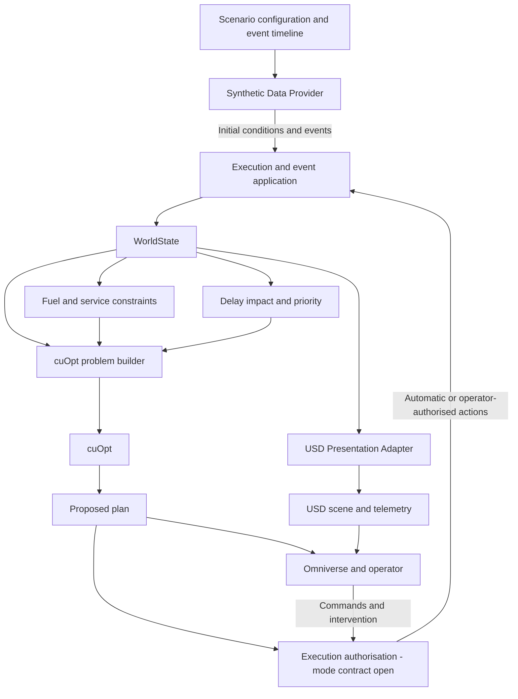

# Fuel Logistics — Architecture

**Status:** Working draft; ownership principles agreed in discussion, component
and event contracts incomplete

**Last updated:** 29 October 2026

**Primary decision:** D-001

**Review questions:** Q-01, Q-02, Q-13; asset-swap dependency Q-11

See the [requirements index](README.md) for decision status, review order and the
resume checkpoint. Component names and interfaces below are conceptual, not
implemented Python classes or a final package layout.

## System responsibilities

| Component | Inputs | Responsibility and outputs | Boundary |
| --- | --- | --- | --- |
| Synthetic Data Provider (original Module 0) | Scenario configuration, seed, scripted timeline | Supply initial conditions and time-stamped flight/schedule/readiness events; retain replay inputs | Does not calculate uplift, invent favourable solver results or independently overwrite resource balances |
| WorldState and execution/state accounting | Initial conditions, events and accepted actions | Own current entity state, applied movements, fuel transfers and resulting events | The precise event applier and mutation protocol remain open |
| Physical fuel and service constraints (Module 2) | Flight legs, profiles, current fuel and service readiness | Calculate uplift, travel/service times, replenishment needs and physical-feasibility diagnostics | Does not generate arbitrary synthetic demand; see the [fuel model](fuel_and_service_model.md) |
| Delay impact and priority assessment (Module 1) | ETA/ETD, flight/cargo category, readiness, time margin and policy | Produce an explainable internal priority score | Does not determine landing priority; see [planning](planning_and_operator_workflow.md) |
| cuOpt problem builder and solver integration (Module 3) | Current state, demands, priorities, network, time windows and commitments | Produce a proposed service order, routes, timings and feasibility/unserved-demand evidence | Does not apply its proposal to current world state |
| Execution authorisation and operator control | Validated proposed plan, operating policy and UI actions | Support automatic dispatch and mode-dependent confirmation/intervention | Automatic dispatch is required; mode definitions, command ownership and approval boundaries remain open (Q-13) |
| USD Presentation Adapter | State and the appropriate plan/proposal information | Bind logical entities to scene objects and author display state | Projection rules are owned by the [USD contract](usd_presentation_contract.md) |
| Omniverse presentation | USD scene, telemetry and proposed/accepted plan information | Show routes, assignments, fuel, delays and reasons for changes; collect operator actions | Visual display does not establish execution or solver correctness |

Houdini is the asset/data preparation environment. It does not become the owner
of runtime logistics state through this requirements split.

## State ownership

**D-001 — agreed in discussion:** `WorldState` is the single authoritative source
of current calculated state. The Synthetic Data Provider supplies initial data
and events. Simulation rules and the execution policy govern changes. Automatic
dispatch is required by the 29 October clarification; operator confirmation is
mode-dependent and still requires definition (Q-13). cuOpt returns results to the
execution layer rather than independently mutating WorldState. This ownership
boundary does not require a human to approve every result.

The original proposal also assigns snapshot/event-log publication and
“authoritative simulated changes” to the provider. This wording is retained as
an **open ownership conflict**, not a second state authority. Decide whether the
provider merely exposes applied results or whether publication belongs to a
separate state/replay component. Snapshot names such as `WorldSnapshot` do not
settle ownership.

## Data and command flow

The following view organises the recorded direction; event-application details
are still open:

The confirmed projection direction is defined in [D-002](usd_presentation_contract.md#ownership-and-direction).
Operator commands form a separate input path; displaying state does not make
USD telemetry an input authority for the calculation layer.

The planned loop is event-driven and rolling-horizon. Potential replanning
triggers include ETA/ETD changes, new arrivals/diversions, stand readiness,
completed refuelling and replenishment. A configurable planning interval is an
option, not an agreed numerical setting. Do not infer a solver call per render
frame. Replanning and commitment rules live in the [planning document](planning_and_operator_workflow.md#replanning-and-committed-actions).

## Configuration and logical interfaces

The source proposal names `ScenarioConfig`, `FlightEvent`, `WorldSnapshot` and a
replayable event log. Their fields, versions and transport are unapproved.

Keep separate configuration identities for visual assets, aircraft performance,
refueller capability, airfield network and planning rules. The solver consumes
logical IDs, network/coordinate data, capability profiles and current state,
rather than mesh names or model-specific prim paths. Minimum configuration and
swap metadata still need agreement; see [reference profiles](reference_profiles.md#profile-and-asset-binding-requirements).

Changing a compatible visual asset should preserve calculation logic. Changes
to layout, vehicle dimensions or service interfaces require corresponding
profile/network updates and renewed feasibility checks.

## Time, replay and runtime boundaries

The proposal requires reproducible scenario inputs, seed, simulation time and
event order, together with accepted actions and recorded planning results. The
clock owner, timestep, event ordering, reset semantics and exact relationship
between simulation time and USD time remain undecided. Do not assume that a
24 fps scene establishes those rules or guarantees solver determinism.

Standalone Python 3.11.15 and its OpenUSD inspection bindings are separate from
Houdini and Kit embedded Python/USD runtimes. The project environment does not
establish binary compatibility, an installed runtime integration or a working
cuOpt connection. Scene fundamentals remain Y-up, metres and 24 time codes per
second under the existing USD contract.

## Open questions and next steps

- **Q-01:** Name the event/command applier, permitted mutations, snapshot
  publisher and event-log owner. Reconcile the provider's publication wording
  with D-001; specify how a result becomes an accepted action under Q-13.
- **Q-02:** Define simulation clock ownership, ordering of simultaneous events,
  replay inputs, reset behaviour and USD timeline relationship. State the limits
  of reproducibility when a solver is involved.
- **Q-11 dependency:** Specify minimum identity, spatial and capability metadata
  for a valid asset/profile swap without coupling core logic to scene paths.
- **Q-13:** Define execution authorisation for automatic dispatch and any
  operator-confirmed mode. Keep the mode policy separate from solver output and
  the state applier; automatic operation must still use validated actions.

Before approving this document, review the owner of every data-changing arrow
and its failure path against the domain and operator requirements. Keep these
questions in the [central review register](README.md#open-review-register).
