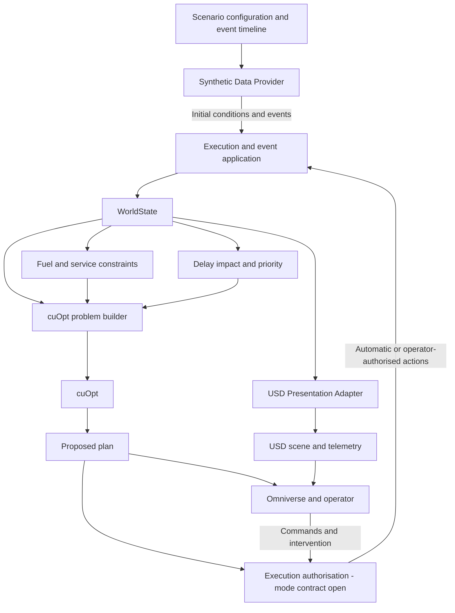

# Fuel Logistics — Architecture

**Status:** Working draft; ownership principles agreed in discussion, component
and event contracts incomplete

**Last updated:** 31 October 2026

**Primary decision:** D-001

**Review questions:** Q-01, Q-02, Q-13; asset-swap dependency Q-11

See the [requirements index](README.md) for decision status, review order and the
resume checkpoint. Component names and interfaces below are conceptual, not
implemented Python classes or a final package layout.

## System responsibilities

| Component | Inputs | Responsibility and outputs | Boundary |
| --- | --- | --- | --- |
| Synthetic Data Provider (original Module 0) | Scenario configuration, seed, scripted timeline | Supply initial conditions and time-stamped flight/schedule/readiness events; retain replay inputs | Does not calculate uplift, invent favourable solver results or independently overwrite resource balances |
| WorldState and execution/state accounting | Initial conditions, events and accepted actions | Own current entity state, applied movements, fuel transfers and resulting events | The precise event applier and mutation protocol remain open |
| Physical fuel and service constraints (Module 2) | Flight legs, profiles, aircraft fuel, all three refueller stocks and service readiness | Calculate uplift, movement/pumping consumption, timed depot operations, replenishment needs and feasibility diagnostics | Keeps aviation fuel, tractor diesel and pump petrol separate; see the [fuel model](fuel_and_service_model.md) |
| Delay impact and priority assessment (Module 1) | ETA/ETD, flight/cargo category, readiness, time margin and policy | Produce an explainable internal priority score | Does not determine landing priority; see [planning](planning_and_operator_workflow.md) |
| cuOpt problem builder and solver integration (Module 3) | Current state, demands, priorities, network, time windows and commitments | Produce a proposed service order, routes, timings and feasibility/unserved-demand evidence | Does not apply its proposal to current world state |
| Execution authorisation and operator control | Validated proposed plan, operating policy and UI actions | Support automatic dispatch and mode-dependent confirmation/intervention | Automatic dispatch is required; mode definitions, command ownership and approval boundaries remain open (Q-13) |
| USD Presentation Adapter | State and the appropriate plan/proposal information | Bind logical entities to scene objects and author display state | Projection rules are owned by the [USD contract](usd_presentation_contract.md) |
| Omniverse presentation | USD scene, telemetry and proposed/accepted plan information | Show routes, assignments, fuel, delays and reasons for changes; collect operator actions | Visual display does not establish execution or solver correctness |

Houdini is the asset/data preparation environment. It does not become the owner
of runtime logistics state through this requirements split.

## State ownership

D-031/D-035 fix planned-maintenance and detected-fault handling. Q-14 must select
the provider's concrete fault catalogue, mobility effects, timing and
reproducibility data; that selection does not block the agreed withdrawal rule.
Pump failure during aircraft refuelling is only a candidate. The provider emits
events; WorldState/execution applies reviewed unavailability, transfer stopping,
assignment and recovery effects. It must not fabricate completed delivery or
repair, independently rewrite fuel balances or assume all faults immobilise the
tractor. No fault-event schema or probability model is selected yet.

**D-001 — agreed in discussion:** `WorldState` is the single authoritative source
of current calculated state. The Synthetic Data Provider supplies initial data
and events. Simulation rules and the execution policy govern changes. Automatic
dispatch is required by the 29 October clarification; operator confirmation is
mode-dependent and still requires definition (Q-13). cuOpt returns results to the
execution layer rather than independently mutating WorldState. This ownership
boundary does not require a human to approve every result.

The original proposal also assigns snapshot/event-log publication and
“authoritative simulated changes” to the provider. This wording is retained as
an **open ownership conflict**, not a second state authority. Decide whether the
provider merely exposes applied results or whether publication belongs to a
separate state/replay component. Snapshot names such as `WorldSnapshot` do not
settle ownership.

D-032/D-038 distinguish Alert waiting, aircraft Refueling and the separate
Alert Refueling diesel-assistance state.
WorldState/execution must distinguish fuel type, donor/recipient roles and
task destination; a shared state name does not imply shared balance updates.
Assistance scenario locations are traversable, and a busy donor becomes available
after its current committed work; blocked-road/disaster branches are outside
this scenario. These contracts do not implement an assistance dispatcher.

D-035 requires immediate service withdrawal and technical unavailability on a
detected fault. If mobile, use ToDepot with that unavailability/reason retained,
then Maintenance on actual repair-area arrival. A vehicle unable to move stays
Alert pending separately scoped recovery; do not simulate an impossible return.
Normal assignment, final-service commitment and coverage policies cannot keep
a faulty vehicle working merely to finish a delivery or wait for replacement.

## Data and command flow

D-006/D-007 define eight aircraft states and actual-event transitions, including
Departing between Ready and Departed. D-036 requires aircraft Alert after a
tanker fault and actual replacement-service start before resumption. D-039
cancels the undelivered commitment if the flight is cancelled in Alert before
replacement arrival; delivered fuel stays onboard. WorldState applies those
effects together with request/assignment changes, not through USD animation.

D-037 requires the current flight's check window and retained stock before
Ready, including after a delivery for an earlier flight. Ready is irreversible
for every event/command source: the provider must not generate reversals and
execution must reject operator cancellation, replacement and readiness loss.
Actual movement starts Departing; airborne zone exit ends participation.
This is a declared demonstration simplification, not a live-airport guarantee.

D-040 keeps agreed ETD, predicted departure and actual movement/take-off
distinct. Operator confirmation is required to change an existing scheduled
ETD; automatic tanker dispatch remains required under Q-13. Keeping a schedule
does not make an infeasible deadline feasible. A late-ready aircraft continues
its actual departure sequence with lateness retained, without waiting for a
past event or silently changing ETD. Exact time records/event ordering remain open.

D-033/D-034 require separate flight, aircraft, request and started-service
commitment identities. The provider can supply explicit flight cancellation and
later assign a new flight to the same parked aircraft. Execution preserves the
original running-service conditions despite withdrawal/cancellation, rejects
late manual interruption, and applies actual transfers until completion or a
technical fault. D-039 is the explicit exception for the undelivered obligation
after interruption and before replacement arrival. Cancellation must not delete the physical aircraft,
reset its fuel or turn a completed delivery into an unserved request. Concrete
identity/version/event-ordering formats remain open. Repeated cancellation and
stale replacement-start commands must not revive cancelled work or repeat a
fuel transfer. A changed flight's future check window cannot be opened early
merely because an earlier committed delivery has finished.

The following view organises the recorded direction; event-application details
are still open:

The confirmed projection direction is defined in [D-002](usd_presentation_contract.md#ownership-and-direction).
Operator commands form a separate input path; displaying state does not make
USD telemetry an input authority for the calculation layer.

The planned loop is event-driven and rolling-horizon. Potential replanning
triggers include ETA/ETD changes, new arrivals/diversions, stand readiness,
completed refuelling and replenishment. A configurable planning interval is an
option, not an agreed numerical setting. Do not infer a solver call per render
frame. Replanning and commitment rules live in the [planning document](planning_and_operator_workflow.md#replanning-and-committed-actions).

D-024 requires waiting/allocation reassessment on every arrival/departure
schedule addition or change, expected fuel-check-window opening and the Staging
Point dwell-threshold crossing. A check that creates no request triggers a new
one-hour look-ahead. D-025/D-027 first review assignments for known demand;
a selected replenishment plan can trigger proactive depot return
and actual Standby dispatch to field parking under D-026, without waiting for an
aircraft-service request. Physical coverage must remain at least one ready
refueller on the field. Replacement parking arrival precedes aircraft dispatch;
future schedule knowledge remains distinct from an executable service request.
These are required event semantics,
not an implementation or a selected event-processing API; same-time ordering
remains open under Q-02.
For an existing flight's ETD, D-040 distinguishes an unaccepted proposal from an
applied operator-confirmed change. Only the latter changes the authoritative
schedule/window used for executable waiting, assignment and movement decisions.

D-027 requires the planning layer to compare joint aircraft assignments, service
order and replenishment timing for the two-vehicle fleet. Both refuellers may
remain on the field; depot Standby is a default arrangement rather than a fixed
one-vehicle limit. A candidate's fuel infeasibility must not directly force a
depot-return command before assignment review. Evaluate route/diesel cost and
service outcomes against EDF using equivalent constraints and information.

## Configuration and logical interfaces

The source proposal names `ScenarioConfig`, `FlightEvent`, `WorldSnapshot` and a
replayable event log. Their fields, versions and transport are unapproved.

Keep separate configuration identities for visual assets, aircraft performance,
refueller capability, airfield network and planning rules. The solver consumes
logical IDs, network/coordinate data, capability profiles and current state,
rather than mesh names or model-specific prim paths. Minimum configuration and
swap metadata still need agreement; see [reference profiles](reference_profiles.md#profile-and-asset-binding-requirements).

Changing a compatible visual asset should preserve calculation logic. Changes
to layout, vehicle dimensions or service interfaces require corresponding
profile/network updates and renewed feasibility checks.

## Time, replay and runtime boundaries

The proposal requires reproducible scenario inputs, seed, simulation time and
event order, together with accepted actions and recorded planning results. The
clock owner, timestep, event ordering, reset semantics and exact relationship
between simulation time and USD time remain undecided. Do not assume that a
24 fps scene establishes those rules or guarantees solver determinism.

Standalone Python 3.11.15 and its OpenUSD inspection bindings are separate from
Houdini and Kit embedded Python/USD runtimes. The project environment does not
establish binary compatibility, an installed runtime integration or a working
cuOpt connection. Scene fundamentals remain Y-up, metres and 24 time codes per
second under the existing USD contract.

## Open questions and next steps

- **Q-01:** Name the event/command applier, permitted mutations, snapshot
  publisher and event-log owner. Reconcile the provider's publication wording
  with D-001; specify how a result becomes an accepted action under Q-13.
- **Q-02:** Define simulation clock ownership, ordering of simultaneous events,
  replay inputs, reset behaviour and USD timeline relationship. State the limits
  of reproducibility when a solver is involved.
- **Q-11 dependency:** Specify minimum identity, spatial and capability metadata
  for a valid asset/profile swap without coupling core logic to scene paths.
- **Q-13:** Define execution authorisation for automatic dispatch and any
  operator-confirmed mode. Keep the mode policy separate from solver output and
  the state applier; automatic operation must still use validated actions.

Before approving this document, review the owner of every data-changing arrow
and its failure path against the domain and operator requirements. Keep these
questions in the [central review register](README.md#open-review-register).
