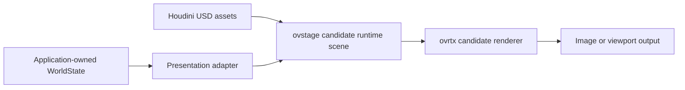
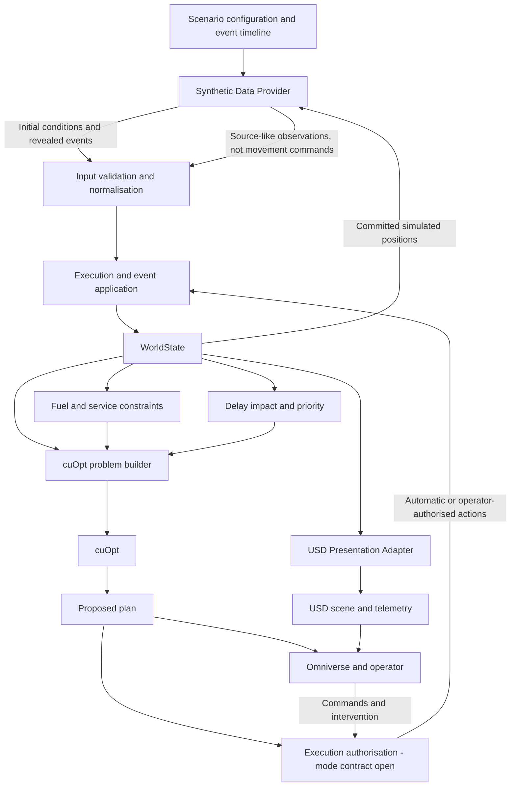

# Fuel Logistics — Architecture

**Status:** Working draft; state ownership and standalone-library direction
recorded; component/event contracts and candidate-library validation incomplete

**Last updated:** 11 November 2026

**Primary decisions:** D-001, D-046, D-047

**Review questions:** Q-01, Q-02, Q-13, Q-15, Q-16, Q-17; asset-swap dependency Q-11

See the [requirements index](README.md) for decision status, review order and the
resume checkpoint. Component names and interfaces below are conceptual, not
implemented Python classes or a final package layout.

## System responsibilities

| Component | Inputs | Responsibility and outputs | Boundary |
| --- | --- | --- | --- |
| Synthetic Data Provider (original Module 0) | Scenario configuration, seed, scripted timeline, committed simulated position snapshots, clock and spatial mapping | Supply scenario events and synthesise source-like position observations from the same simulated movement; retain replay inputs | Scenario and observation responsibilities are distinct inside M0; does not create another trajectory, reapply movement or mutate WorldState |
| WorldState and execution/state accounting | Initial conditions, events and accepted actions | Own current entity state, applied movements, fuel transfers and resulting events | The precise event applier and mutation protocol remain open |
| Airfield Spatial Model | Effective network, layout and coordinate reference | Expose paths, access, distances and spatial mapping to planning, execution and presentation | Provides one effective spatial view; does not publish network drafts |
| Spatial Network Manager | Admin edit requests, reference geometry, network and profile revisions | Manage network drafts, validation, revision lifecycle and controlled activation requests | Separate planned module; activation and persistence interfaces remain Q-17/Q-16; it does not plan routes or move vehicles |
| Physical fuel and service constraints (Module 2) | Flight legs, profiles, aircraft fuel, all three refueller stocks and service readiness | Calculate uplift, movement/pumping consumption, timed depot operations, replenishment needs and feasibility diagnostics | Keeps aviation fuel, tractor diesel and pump petrol separate; see the [fuel model](fuel_and_service_model.md) |
| Delay impact and priority assessment (Module 1) | ETA/ETD, flight/cargo category, readiness, time margin and policy | Produce an explainable internal priority score | Does not determine landing priority; see [planning](planning_and_operator_workflow.md) |
| cuOpt problem builder and solver integration (Module 3) | Current state, demands, priorities, network, time windows and commitments | Use cuOpt to calculate proposed refueller-to-aircraft assignments, service order, visit routes/timings and feasibility/unserved-demand evidence; translate its result for validation/adoption | Influences actual dispatch through the accepted plan; execution applies resulting WorldState changes |
| Execution authorisation and operator control | Validated proposed plan, operating policy and UI actions | Support automatic dispatch and mode-dependent confirmation/intervention | Automatic dispatch is required; mode definitions, command ownership and approval boundaries remain open (Q-13) |
| USD Presentation Adapter | State and the appropriate plan/proposal information | Bind logical entities to scene objects and author display state | Projection rules are owned by the [USD contract](usd_presentation_contract.md) |
| Omniverse presentation | USD scene, telemetry and proposed/accepted plan information | Show routes, assignments, fuel, delays and reasons for changes; collect operator actions | Visual display does not establish execution or solver correctness |
| Persistence and history access | Validated state changes, operation facts, position samples and query/recovery requests | Commit coherent records, retain request/telemetry history and restore committed state | Proposed MySQL split and transaction/recovery contracts remain Q-16; no independent business-state mutation |
| Module settings management | Primary settings database, bootstrap files and admin requests | Validate/version settings, expose effective configuration and request controlled activation | File/DB precedence and live/restart rules remain Q-13/Q-16; no rewriting domain history |

Houdini is the asset/data preparation environment. It does not become the owner
of runtime logistics state through this requirements split.

## Input sources and synthetic position telemetry (D-047)

**Agreed in discussion — 1 November 2026; implementation point 0:** There is
no connection to real airport systems. Implement the Synthetic Data Provider
against an explicit input-source contract and reserve interfaces/placeholders
for future real-data adapters. Implementing the adapters themselves, including
their real-system connectors, transports and integrations, is outside the
Case 04 implementation scope. Placeholders do not fetch, transform or supply
real source data; they reserve the interface for a future implementation.

Both a synthetic provider and a future real adapter must deliver normalised
events/observations through the same boundary. Define identity, event/sample
time, units, coordinate frame and source provenance before coupling consumers
to a provider. An input adapter does not independently change fuel balances or
state machines: application of accepted input belongs to the WorldState/execution
owner under D-001. This seam does not itself establish compatibility with an
unspecified airport system or authorise physical control.

Refueller and aircraft position telemetry will imitate GPS coordinates using
synthetic positions relative to the stands, depot and other infrastructure.
No recorded GPS tracks or live positioning feed are used. Position telemetry
must agree with simulated movement and the authoritative WorldState; do not
generate a second independent movement history or apply the same movement twice.

Define a common airfield reference frame and an explicit mapping between
synthetic GPS-like coordinates, the ground network and the metre-scale Y-up USD
scene. Geographic and scene coordinates must not be used interchangeably.
The concrete packet fields, geographic representation and mapping remain to be
specified under Q-01/Q-02/Q-04/Q-10/Q-11; this records the required seam and data
origin without selecting an unreviewed schema or a surveyed real-airport map.

The [C4 architecture draft](../../architecture/case04_c4_architecture.md)
shows the source seam alongside the original Module 0–3 roles and the rest of
the application. Review that module map before deriving an implementation order.

### Shared airfield georeference

Define one effective, versioned spatial reference for the airfield, shared by
the Spatial Model, Synthetic Data Provider, input normalisation, planning,
execution, history and presentation as applicable. This is shared configuration,
not a requirement for a single global file or a new service. Settings Manager
coordinates effective configuration through the settings/persistence boundary;
the Spatial Model supplies the reviewed mapping. Data ownership, storage,
activation and runtime interfaces remain Q-11/Q-16/Q-17.

The reference must identify:

- The geographic position of a selected reference point: latitude, longitude,
  geodetic coordinate reference/datum and, when used, height with its vertical
  reference and units. Select a reference such as WGS84 only after review.
- The corresponding point in the local airfield/USD frame, not necessarily the
  world origin, and transforms between asset/layout and airfield frames.
- The local axes, handedness and rotation relative to geographic north/east,
  including a declared rotation convention. Scene coordinates use metres and
  Y-up under the existing USD contract; compass orientation remains open.
- The transformation method, valid spatial extent, precision and treatment of
  altitude, to be selected and validated against the chosen reference systems.

For synthetic observations, transform the committed simulated position through
the effective reference into the chosen geographic representation. The source
position, observation, spatial dataset and active reference must be compatible
and identifiable by revision. The observation does not move the object again.
Retain sufficient reference/configuration identity with runs and historical
observations to interpret earlier results without silently applying a new mapping.

Validate inputs and incompatible frames before activation. A reference change
can affect positions, networks, routes, history and synthetic outputs; it needs
a reviewed transition/restart policy. Define handling for invalid or unavailable
references, rounding, axis order and height conventions. Actual coordinates,
orientation, datum, conversion library and required accuracy are not selected or
implemented here. Real adapters and live switching remain outside scope.

### Scenario inputs and synthetic observations — 11 November clarification

Model the external information sources around the twin without introducing a
second motion simulator. The existing Synthetic Data Provider (M0) has two
logical responsibilities; this distinction does not require two new modules:

1. **Scenario supply:** define reproducible initial conditions and time-stamped
   flight, schedule and readiness events. Reveal them through the input boundary
   according to the simulation clock; do not reveal hidden future events.
2. **Source-like observations:** derive time-stamped position messages from the
   same committed simulation snapshots that describe actual aircraft/refueller
   movement, using the spatial mapping and an explicit source identity. Send
   these messages through the common input boundary. Synthetic source identities
   model distinct feeds; they do not imply separate deployable services.

Execution owns simulated movement and publishes the committed WorldState
position. A generated observation reflects that position, with its source
revision and measurement time, and is not another movement command. Accepting
the synthetic observation must not advance motion or apply fuel, service or
state transitions a second time. The observation and the committed position
are related evidence, not independent validation of each other. Define cadence,
latency, uncertainty and stale/missing-sample policy before claiming realistic
sensor fidelity; exact, zero-delay sampling may serve an initial test if stated.

The input boundary validates and normalises events/observations. Execution
decides permitted state effects and publishes accepted results; History Recorder
records committed state and evidence, rather than generating the source feed.
UI/scene projection consumes accepted state and does not own either motion or
input. Agree event ordering, source revision, timestamps and loop prevention
under Q-01/Q-02; resolve the shared reference and GPS mapping under Q-11.

A hypothetical real-data mode would instead receive external observations.
It must explicitly select the authoritative position source per entity and mode,
and define reconciliation, stale/unavailable data and transition behaviour so
simulated movement cannot compete with an external observation. This is an
architecture seam only: real-data adapters, mode switching and actual live
integration are not implemented or included in the present scope. Whether an
independent simulated ground-truth model is ever needed for richer sensor testing
is an open design question, not an additional movement authority today.

## Standalone Omniverse library direction (D-046)

**Direction agreed — 1 November 2026:** Target Case 04 as an independently
controlled logistics application integrating selected standalone Omniverse
libraries. The host application owns the domain state, execution scheduling
and application lifecycle; the libraries provide selected scene/presentation
capabilities. This complements the Kit application and extension evidence in
Case 03 with practical library-integration evidence in Case 04.

The technical reason is the existing separation between authoritative
`WorldState`, planning/execution and one-way scene projection. Preserve that
boundary as the renderer is integrated. Library selection must support the
logistics demonstration and its cinematic presentation; a larger library
count is not an acceptance criterion.

**Initial candidates for evaluation:** `ovstage` for runtime scene data and
`ovrtx` for embedded RTX visualisation. The proposed integration boundary is:

This is a logical ownership view, not a selected API or approved field mapping.
`ovstage` runtime scene data is distinct from a `pxr.Usd.Stage` and from the
authoritative logistics model. The exact USD-to-runtime bridge, update path,
supported attributes/materials and reset behaviour require validation under
Q-10/Q-15. Keep D-002's one-way projection and the existing USD fundamentals;
do not assume that arbitrary USD primvars automatically become visible labels
or gauges. The application boundary owns scheduling; the internal clock owner,
timestep and event-ordering rules remain Q-01/Q-02.

Fuel arithmetic, aircraft/request/refueller state machines and service guards
remain application responsibilities. cuOpt remains the planned routing solver;
neither scene storage nor rendering replaces it. Add `ovphysx` only if a concrete
physical-simulation requirement justifies it. Importing `pxr`/`usd-core`, using
cuOpt or running a Kit application headlessly does not by itself demonstrate
standalone Omniverse library integration.

### Prototype gate and adoption boundary

Before committing the final runtime stack, demonstrate a small standalone
prototype using an actual project USD asset. It must render through the candidate
library, update a visible object from application-owned state/time, and repeat
initialisation, reset and shutdown correctly. Start with a TZ-22 when available
or another real project asset; a vendor sample alone is not project-integration
evidence. See the [proof criteria](scenarios_and_validation.md#library-integration-proof-d-046).

Check the selected releases on the target Windows/GPU/driver/Python combination,
record package versions and assess the work needed for the interactive viewport,
operator UI and HUD. A single rendered frame does not establish those features.
The evaluated NVIDIA documentation marks these libraries as pre-release, so
packaging, APIs and compatibility must be checked for the chosen versions.
No performance advantage over Kit is assumed.

**Agreed now:** The standalone-library evidence goal and application-owned
runtime boundary. **Pending Q-15:** Final libraries/versions, compatibility,
deployment, presentation/UI implementation and the prototype result. This
direction does not establish an installed SDK, working integration or approval
to change the Python baseline. It refines the earlier planned Isaac Sim/Kit
presentation assumption; that earlier baseline is not evidence of an implemented
runtime. After the prototype, record the platform decision in an ADR and
synchronise the project README and dependency/runtime contracts.

Evaluation references, consulted on 1 November 2026:

- [NVIDIA OVRTX](https://github.com/NVIDIA-Omniverse/ovrtx/blob/main/README.md):
  embedding RTX visualisation and its relationship to ovstage.
- [NVIDIA OVStage](https://nvidia-omniverse.github.io/ovstage/): runtime scene
  data and pre-release status.
- [NVIDIA's framework/library decision guide](https://developer.nvidia.com/blog/integrate-physical-ai-capabilities-into-existing-apps-with-nvidia-omniverse-libraries/):
  application ownership and selective capability integration.

## State ownership

D-031/D-035 fix planned-maintenance and detected-fault handling. D-044 selects
the concrete events; Q-14 still owns exact timing, repair evidence, reproducibility
data and any additional recovery scope. These details do not reopen withdrawal.
D-044 selects pump failure/petrol exhaustion during Refueling and a mobile
tyre-puncture case during Repositioning; service-time diesel exhaustion is excluded.
The provider emits
events; WorldState/execution applies reviewed unavailability, transfer stopping,
assignment and recovery effects. It must not fabricate completed delivery or
repair, independently rewrite fuel balances or assume all faults immobilise the
tractor. No fault-event schema or probability model is selected yet.

**D-001 — agreed in discussion:** `WorldState` is the single authoritative source
of current calculated state. The Synthetic Data Provider supplies initial data
and events. Simulation rules and the execution policy govern changes. Automatic
dispatch is required by the 29 October clarification; operator confirmation is
mode-dependent and still requires definition (Q-13). cuOpt returns results to the
execution layer rather than independently mutating WorldState. This ownership
boundary does not require a human to approve every result.

The original proposal also assigns snapshot/event-log publication and
“authoritative simulated changes” to the provider. This wording is retained as
an **open ownership conflict**, not a second state authority. Decide whether the
provider merely exposes applied results or whether publication belongs to a
separate state/replay component. Snapshot names such as `WorldSnapshot` do not
settle ownership.

D-032/D-038 distinguish Alert waiting, aircraft Refueling and the separate
Alert Refueling diesel-assistance state.
WorldState/execution must distinguish fuel type, donor/recipient roles and
task destination; a shared state name does not imply shared balance updates.
Assistance scenario locations are traversable, and a busy donor becomes available
after its current committed work; blocked-road/disaster branches are outside
this scenario. These contracts do not implement an assistance dispatcher.

D-035 requires immediate service withdrawal and technical unavailability on a
detected fault. If mobile, use ToDepot with that unavailability/reason retained,
then Maintenance on actual repair-area arrival. A vehicle unable to move stays
Alert pending separately scoped recovery; do not simulate an impossible return.
Normal assignment, final-service commitment and coverage policies cannot keep
a faulty vehicle working merely to finish a delivery or wait for replacement.

## Data and command flow

D-006/D-007 define eight aircraft states and actual-event transitions, including
Departing between Ready and Departed. D-036 requires aircraft Alert after a
tanker fault and actual replacement-service start before resumption. D-039
cancels the undelivered commitment if the flight is cancelled in Alert before
replacement arrival; delivered fuel stays onboard. WorldState applies those
effects together with request/assignment changes, not through USD animation.

D-037 requires the current flight's check window and retained stock before
Ready, including after a delivery for an earlier flight. Ready is irreversible
for every event/command source: the provider must not generate reversals and
execution must reject operator cancellation, replacement and readiness loss.
Actual movement starts Departing; airborne zone exit ends participation.
This is a declared demonstration simplification, not a live-airport guarantee.

D-040 keeps agreed ETD, predicted departure and actual movement/take-off
distinct. Operator confirmation is required to change an existing scheduled
ETD; automatic tanker dispatch remains required under Q-13. Keeping a schedule
does not make an infeasible deadline feasible. A late-ready aircraft continues
its actual departure sequence with lateness retained, without waiting for a
past event or silently changing ETD. Exact time records/event ordering remain open.

D-033/D-034 require separate flight, aircraft, request and started-service
commitment identities. The provider can supply explicit flight cancellation and
later assign a new flight to the same parked aircraft. Execution preserves the
original running-service conditions despite withdrawal/cancellation, rejects
late manual interruption, and applies actual transfers until completion or a
technical fault. D-039 is the explicit exception for the undelivered obligation
after interruption and before replacement arrival. Cancellation must not delete the physical aircraft,
reset its fuel or turn a completed delivery into an unserved request. Concrete
identity/version/event-ordering formats remain open. Repeated cancellation and
stale replacement-start commands must not revive cancelled work or repeat a
fuel transfer. A changed flight's future check window cannot be opened early
merely because an earlier committed delivery has finished.

The following view organises the recorded direction; event-application details
are still open:

The confirmed projection direction is defined in [D-002](usd_presentation_contract.md#ownership-and-direction).
Operator commands form a separate input path; displaying state does not make
USD telemetry an input authority for the calculation layer.

The planned loop is event-driven and rolling-horizon. D-045 limits each solve
to one or two known requests without discarding the full queue or exposing hidden
future events. Scenario replay may retain a timeline the planner cannot yet see.
Potential replanning
triggers include ETA/ETD changes, new arrivals/diversions, stand readiness,
completed refuelling and replenishment. A configurable planning interval is an
option, not an agreed numerical setting. Do not infer a solver call per render
frame. Replanning and commitment rules live in the [planning document](planning_and_operator_workflow.md#replanning-and-committed-actions).

D-024 requires waiting/allocation reassessment on every arrival/departure
schedule addition or change, expected fuel-check-window opening and the Staging
Point dwell-threshold crossing. A check that creates no request triggers a new
one-hour look-ahead. D-025/D-027 first review assignments for known demand;
a selected replenishment plan can trigger proactive depot return
and actual Standby dispatch to field parking under D-026, without waiting for an
aircraft-service request. Physical coverage must remain at least one ready
refueller on the field. Replacement parking arrival precedes aircraft dispatch;
future schedule knowledge remains distinct from an executable service request.
These are required event semantics,
not an implementation or a selected event-processing API; same-time ordering
remains open under Q-02.
For an existing flight's ETD, D-040 distinguishes an unaccepted proposal from an
applied operator-confirmed change. Only the latter changes the authoritative
schedule/window used for executable waiting, assignment and movement decisions.

D-027 requires the planning layer to compare joint aircraft assignments, service
order and replenishment timing for the two-vehicle fleet. Both refuellers may
remain on the field; depot Standby is a default arrangement rather than a fixed
one-vehicle limit. A candidate's fuel infeasibility must not directly force a
depot-return command before assignment review. Evaluate route/diesel cost and
service outcomes against EDF using equivalent constraints and information.

## Configuration and logical interfaces

The source proposal names `ScenarioConfig`, `FlightEvent`, `WorldSnapshot` and a
replayable event log. Their fields, versions and transport are unapproved.

Keep separate configuration identities for visual assets, aircraft performance,
refueller capability, airfield network and planning rules. The solver consumes
logical IDs, network/coordinate data, capability profiles and current state,
rather than mesh names or model-specific prim paths. Minimum configuration and
swap metadata still need agreement; see [reference profiles](reference_profiles.md#profile-and-asset-binding-requirements).

D-042 deliberately binds KrAZ-221 + TZ-22 visuals to a KrAZ-258B1 + TZ-22
operational profile. D-043 adds explicit Standby/RefillTank/RefillServiceFuel and
uses Repositioning for timed internal depot movement. No separate Active/Standby
role variables are needed; technical availability, task and field coverage still
require their own checks. Internal depot travel and aircraft Refueling consume
zero tractor diesel under the selected model; pumping consumes separate petrol.
D-041 closes normal full delivery as Completed and archives every request with
actual transfer/executor history, without replacing WorldState as state owner.
These agreements select requirements, not Python classes or a storage schema.

Changing a compatible visual asset should preserve calculation logic. Changes
to layout, vehicle dimensions or service interfaces require corresponding
profile/network updates and renewed feasibility checks.

## Proposed spatial-network administration (Q-17)

The [spatial-network administration draft](spatial_network_administration.md)
captures the proposed administrator workflow, validation and activation risks.
The separate Spatial Network Manager owns network draft editing, validation
orchestration, revision lifecycle and activation requests. The Spatial Model
supplies the effective spatial network to planning and execution. Detail the
interfaces and activation boundary with Settings Manager, administration,
Persistence and execution. Graph storage, USD representation and inclusion of
an editor in the first demonstration remain open.

Activation must identify the network revision and account for positions, routes,
commitments and stale planning results. Exact authority and ordering remain
Q-01/Q-02/Q-13/Q-16; Q-17 records the cross-cutting spatial review.

## Persistence and database separation (proposal)

The architecture review proposes one MySQL server with `af_core` for durable
state/requests/actual transfers, `af_telemetry` for synthetic position/measurement
history, `af_analytics` for derived fuel/run reports and `af_settings` for primary
module configuration. Working names and
physical schemas are not yet selected implementations. See the
[storage contract](persistence_and_storage.md) and the updated C4 storage contour.

Execution owns the semantics of a change; Persistence owns coherent database
commit and recovery. Publish a changed WorldState revision only after its
required state/facts have been committed. Current positions, stocks, request
state, assignments and simulation time must restore consistently; history must
retain completed/cancelled requests and earlier coordinates. Derived analytics
is not the only copy of actual fuel transfers and cannot rewrite balances.

Q-16 owns the storage split, transaction boundaries, telemetry cadence,
idempotency, durability and backup/recovery checks. Q-01/Q-02/Q-05 retain the
domain mutation, event/time and identity contracts. The storage proposal does
not itself choose their unresolved semantics or configure a MySQL server.

Settings Manager mediates database-backed module settings and an administration
page/panel. The administration surface also submits network edits to Spatial
Network Manager; graph revision ownership and storage are distinct from module
settings. Critical startup values are duplicated in local bootstrap files to
initialise storage access. Define copy/override precedence, validate edits and
distinguish configured/effective versions. Record effective configuration per
run and apply explicit live/replan/restart rules. Preserve active service and
history; bootstrap defaults cannot replace unavailable persistent accounting.
See the [settings proposal](persistence_and_storage.md#module-settings-bootstrap-files-and-administration).

## Time, replay and runtime boundaries

The proposal requires reproducible scenario inputs, seed, simulation time and
event order, together with accepted actions and recorded planning results. The
clock owner, timestep, event ordering, reset semantics and exact relationship
between simulation time and USD time remain undecided. Do not assume that a
24 fps scene establishes those rules or guarantees solver determinism.

Standalone Python 3.11.15 and its OpenUSD inspection bindings are separate from
Houdini and Kit embedded Python/USD runtimes and do not establish compatibility
with the D-046 candidate libraries. The project environment does not establish
binary compatibility, an installed runtime integration or a working cuOpt
connection. Scene fundamentals remain Y-up, metres and 24 time codes per second
under the existing USD contract.

## Open questions and next steps

- **Q-17:** Specify Spatial Network Manager interfaces, network validation and
  lifecycle, effective revision activation, failure handling and initial scope.

- **Q-01:** Name the event/command applier, permitted mutations, snapshot
  publisher and event-log owner. Reconcile the provider's publication wording
  with D-001; specify how a result becomes an accepted action under Q-13.
- **Q-02:** Define simulation clock ownership, ordering of simultaneous events,
  replay inputs, reset behaviour and USD timeline relationship. State the limits
  of reproducibility when a solver is involved.
- **Q-11 dependency:** Specify minimum identity, spatial and capability metadata
  for a valid asset/profile swap without coupling core logic to scene paths.
- **Q-13:** Define execution authorisation for automatic dispatch and any
  operator-confirmed mode. Keep the mode policy separate from solver output and
  the state applier; automatic operation must still use validated actions.
- **Q-15:** Validate D-046's library prototype, Windows/GPU/driver/Python and
  package compatibility, scene-update/lifecycle path, viewport/HUD/UI scope and
  deployment. Select and record the final runtime stack after that evidence;
  preserve Q-01/Q-02 ownership and Q-10 projection decisions.
- **Q-16:** Review the [persistence contract](persistence_and_storage.md): MySQL
  database separation, coherent commit/restore, request/position history,
  telemetry sampling/checkpoints, durability, idempotency and backup/recovery.
  Include primary module settings, bootstrap-copy precedence, revisions,
  admin changes and controlled live/restart activation.

Before approving this document, review the owner of every data-changing arrow
and its failure path against the domain and operator requirements. Keep these
questions in the [central review register](README.md#open-review-register).
