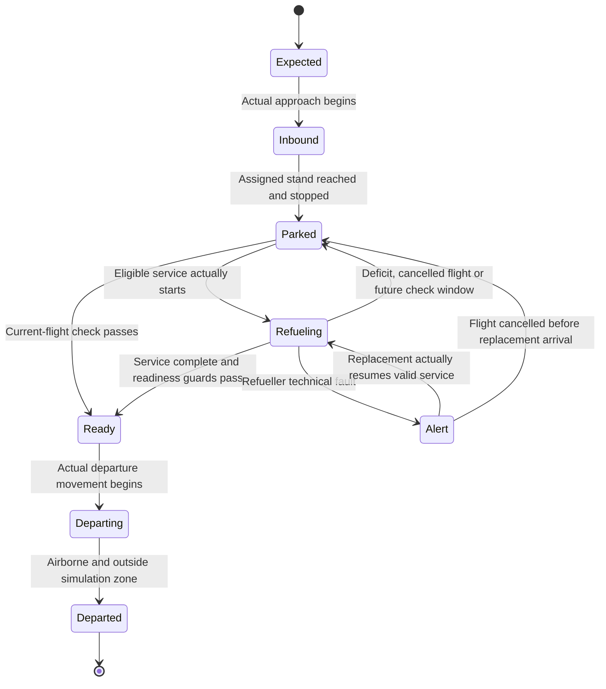

# Fuel Logistics — Domain and State Machines

**Status:** Working draft; tanker transitions 1–4 agreed in discussion for all
three fuel stocks; two-refueller rotation agreed;
safe diesel return and exceptional assistance required; depot transitions 5–7
and three-resource dispatch checks recorded; waiting arrival, direct in-motion
assignment and event-driven waiting/relief rules agreed; remaining details open;
Maintenance framework and fault withdrawal agreed; fault catalogue and recovery detail
open; eight aircraft states and reviewed transitions agreed on 31 October;
request records, event ordering and remaining boundary cases open

**Last updated:** 31 October 2026

**Primary decisions:** D-003, D-006, D-007, D-010, D-012, D-013, D-014, D-015,
D-016, D-017, D-018, D-019, D-020, D-022–D-026, D-030–D-040; dependencies D-021, D-027

**Review questions:** Q-03, Q-04, Q-05, Q-14; fuel dependencies Q-06, Q-07; modes Q-13

See the [requirements index](README.md#resume-checkpoint) for the continuation
point. Review one tanker transition at a time. The tables preserve the source
discussion's scope; open rows are not approved transitions or final enums.

## Entities and lifecycles

**D-003 — direction agreed:** Aircraft, fuel requests and refuellers need
separate lifecycles. One shared `Idle / Transit / Refueling / Maintenance` enum
does not describe them. USD statuses represent internal states; they do not
implement the state machines.

| Concept | Recorded role | Contract still needed |
| --- | --- | --- |
| Flight | Schedule, arrival type, destination/next leg and operational profile | Flight ID versus physical aircraft ID; repeated flights and reassignment |
| Aircraft | Physical service readiness and onboard aviation fuel | Final lifecycle, capacity/profile references and association with a flight |
| Fuel request | A need for fuel service arising automatically or manually | IDs, quantities, eligibility, queue/assignment, completion, rejection and cancellation |
| Refueller | Tractor plus aviation-fuel semi-trailer with its own operational state | Complete transitions, resource guards, location and current assignment |
| Depot | Two exclusive-occupancy posts, agreed simultaneous-arrival order, separate auxiliary diesel/petrol dispensers and two-refueller parking under D-018/D-021 | Service rates, target quantities, remaining visit rules and internal holding/paths/timings |
| Waiting location | Main Parking or Staging Point; arrival and one-hour/event-driven waiting policy under D-022/D-024 | Geometry, accessibility, selection and simultaneous-event ordering |

Arrival type, stop purpose and a fuel-check result are separate data, not extra
enum states. Numerical fuel quantities are defined in [D-005](fuel_and_service_model.md#quantities-and-units).
Exact field names and serialisation beyond the recorded examples remain open.

## Aircraft lifecycle

**D-006 — agreed in discussion, 31 October 2026:** Use exactly eight aircraft
states. `Scheduled` and `Diversion` remain arrival types, not states.

| State | Meaning |
| --- | --- |
| `Expected` | Known arrival whose actual approach has not begun |
| `Inbound` | Actual approach, landing and taxi to the assigned stand |
| `Parked` | Stopped at its stand, awaiting a check, service or a new flight |
| `Refueling` | Aircraft service by a refueller has actually started |
| `Alert` | A refueller fault interrupted aircraft service; awaiting replacement |
| `Ready` | Fuel-ready, committed preparation for departure under D-037 |
| `Departing` | Actual movement from the stand, taxi, take-off run and take-off |
| `Departed` | Airborne and outside the simulation zone; terminal for this scenario |

Aircraft already on stands may initialise in `Parked`; they need not replay an
arrival. Initialisation is not an extra runtime transition. No separate landing,
taxiing, fuel-check or delay-risk state is required.

### Aircraft transitions

| ID | Transition | Trigger and guards | Required outcome |
| --- | --- | --- | --- |
| T1 | `Expected -> Inbound` | Provider reports actual approach start; ETA alone is insufficient | Begin the approach/landing/taxi phase |
| T2 | `Inbound -> Parked` | Assigned stand actually reached and aircraft fully stopped | Apply the current flight's check immediately if its window is already open |
| T3 | `Parked -> Ready` | Current-flight check window open, active flight and sufficient actual onboard fuel | Commit readiness under D-037; otherwise remain Parked and calculate deficit demand |
| T4 | `Parked -> Refueling` | Refueller actually arrives, aircraft eligible/ready to receive fuel and service starts | Commit the agreed service conditions under D-034; setup may be included in service duration |
| T5 | `Refueling -> Ready / Parked` | Agreed operation finishes; evaluate actual stock, current flight and its check window | Ready only if the active current flight's window is open and fuel is sufficient; otherwise Parked. Create additional demand for a current-flight deficit when eligible; a cancelled flight has no active demand |
| T6 | `Ready -> Departing` | Actual movement from the stand for departure begins | Retain the commitment; do not infer movement from ETD alone |
| T7 | `Departing -> Departed` | Aircraft is airborne and has left the simulation zone | End that aircraft's participation in the current scenario |
| T8 | `Refueling -> Alert` | Refueller technical fault interrupts service | Stop transfer, retain actual stock and outstanding committed quantity; faulty refueller follows D-035 |
| T9 | `Alert -> Refueling` | Replacement actually arrives and starts valid resumed service after checks/setup; outstanding commitment has not been cancelled | Transfer only the undelivered committed quantity; do not repeat earlier delivery |
| T10 | `Alert -> Parked` | Flight cancelled before replacement arrival (D-039) | Cancel the outstanding old-request commitment, retain delivered fuel and await a new flight/check |

`Parked -> Refueling` may recur for additional eligible demand. `FuelChecked`
and `Sufficient` are check results, not aircraft states. Service completion and
departure guards must prevent aircraft movement while servicing equipment still
prevents it; detailed teardown and request-closure ordering remain Q-05.

An aircraft awaiting a tanker stays `Parked` until refuelling actually begins;
the request carries waiting/queue information. An inbound flight can be known to
the planner without being physically present or eligible for ground service.
Diversion does not itself establish highest refuelling priority.

The clarified schedule has three aircraft on stands, two inbound flights and a
possible sixth unscheduled arrival. The event can trigger a revised plan. The
earlier requirement for operator confirmation of every such change is reopened:
automatic dispatch is required, while the mode-specific confirmation and
intervention contract is open under [Q-13](planning_and_operator_workflow.md#operator-acceptance-and-unresolved-result-handling).
Physical animation need not depict every logical setup operation. D-037 fixes
committed readiness, not a full ATC or pre-flight inspection model. The eight
aircraft states are agreed; request enums and the remaining Q-05 boundary cases
are not thereby finalised. D-040 separates schedule, prediction and actual
departure. The existing tanker state machine is unchanged by this review.

## Fuel check and request lifecycle

**D-007 — behaviour agreed, numerical timing open:** For each flight, configure ETD and
`predeparture_check_lead_time`. The proposed check time is `ETD - lead_time`;
1–2 hours is an example, not an agreed value. Compare `aircraft.fuel_onboard`
with `required_departure_fuel` from the [fuel model](fuel_and_service_model.md#aircraft-demand-model).

| Outcome | Aircraft effect | Request effect |
| --- | --- | --- |
| Sufficient fuel | `Parked -> Ready` | No refueller call required |
| Insufficient fuel | Remain `Parked` until actual service starts | Create a request for the calculated deficit |
| Refuelling starts | Aircraft and refueller enter their own `Refueling` states | Active-service representation remains to be defined |
| Final check sufficient and current-flight window open | Ready for the active current flight; a cancelled flight remains Parked | Completion/closure record ordering remains to be defined |
| Delivery complete before changed/new flight's window | Parked even if actual stock is already sufficient | Completed delivery is retained; do not create a premature new service request |
| Current-flight check insufficient at its check window (D-037) | Remain Parked, awaiting additional service | Retain/create calculated additional demand using actual onboard fuel; detailed closure/identity remains open |

`FuelChecked / Sufficient` describes a check result, not a persistent aircraft
state. The flight's request has its own lifecycle; no request enum has yet been
agreed. The source proposal's examples of request stages (not requested, pending,
ready, refuelling, completed) are descriptive examples only.

The first routine check creating a flight's service request occurs in Parked,
not inside Refueling. If the check time has passed at actual stand arrival,
perform it immediately after T2. A changed/new flight uses its own window and
retained fuel; delivery completion does not open that window early. If the
window opens during an already committed operation, do not interrupt it or
duplicate its demand; assess readiness after completion. Exact lead time,
ETD-change rescheduling and same-time event ordering remain Q-02/Q-06.
Cancellation/revision follows D-033/D-034 and the D-039 exception below.

**Review finding:** D-014 says the current request is closed after refuelling.
D-007 permits an insufficient final check and request revision. Decide the
ordering and consistent updates of fuel check, request closure and both vehicle
states; do not silently resolve this during restructuring.

## Request cancellation and revision (D-033)

**D-033 — agreed in discussion:** Before service starts, an explicit request
cancellation (for example a flight cancellation or removal of an erroneous
request) releases its tanker assignment. Mark the request cancelled, not
completed. A departure-time change alone does not cancel a request; recalculate
demand/timing and review assignments using the updated information.

If the tanker is already in `ToAircraft`, preserve actual position, travelled
distance, elapsed time and all fuel balances. Apply D-027 fleet assignment
review, then select one of the following:

- Valid alternative request, with all three fuel and route/readiness/time
  guards satisfied from actual position: remain `ToAircraft`, replacing the
  assignment and remaining route immediately, without a waiting-location stop.
- No selected service and no selected replenishment: enter `Repositioning`
  towards a permitted waiting location, then `Idle` on actual arrival.
- Replenishment necessary or preferred by the reviewed fleet plan: enter
  `ToDepot`, preserving protected diesel return and D-026 field coverage.

For a changed request, repeat feasibility and fleet-plan review. Continue to
the same aircraft only if the updated assignment is feasible and retained;
otherwise use the same reassignment/waiting/replenishment branches. No new
aircraft technical-failure scenario is introduced by this rule. Before-service
cancellation also removes unserved demand from the active queue; it does not
erase completed fuel transfers or mark a flight/aircraft departed.

## Started-service commitment and cancelled flights (D-034)

**D-034 — agreed in discussion:** On service start (entry into aircraft-service
`Refueling`, including D-012 setup), retain the request conditions/version under
which service began, including its agreed delivery quantity and identities.
Complete the started service under those conditions despite subsequent request
withdrawal, flight cancellation, schedule change or demand revision. Such events
do not rewrite the active delivery quantity or release the tanker early.
The exact commitment record/version format remains open.

Manual cancellation while committed aircraft service is running is **not allowed**.
The UI must make that restriction clear, and execution must also reject a late
cancellation command rather than relying only on a disabled button. An external
withdrawal/cancellation event may still be recorded, but does not cancel the
committed physical service. Same-time start/cancellation ordering is Q-02.

If the flight is cancelled during refuelling, finish the original committed
delivery and release the tanker using the normal post-service rules. The
physical aircraft remains fuelled and parked on the airfield, with no departure
for that cancelled flight. Represent it using `Parked` with no active flight
after service, rather than inferring `Ready` to depart from fuel sufficiency.
Keep the cancelled flight record distinct from the physical aircraft.

The Synthetic Data Provider may later assign **a new flight to that same
aircraft**. Bind the new flight identity/schedule without spawning a replacement
aircraft or resetting onboard fuel. Evaluate the new flight's fuel requirement
against the actual remaining onboard stock under the agreed check/eligibility
rules; create additional service only for a calculated deficit.

Ordinary cancellation/replanning must not interrupt committed service. D-035
requires immediate aircraft-service withdrawal on any detected technical fault,
even when some equipment can still function; Q-14 selects the event catalogue.
D-034 does not override that technical-fault withdrawal rule.
**31 October exception (D-039):** After fault interruption, cancellation while
the aircraft is Alert and before replacement arrival cancels the old undelivered
commitment. This is not permission to interrupt running service manually.
Completion of the committed delivery and fuel-readiness for an updated/new
flight are distinct outcomes; final-check/request-closure sequencing still
requires the remaining Q-05 contract.

## Aircraft interrupted service and committed readiness (D-036/D-037)

**D-036 — agreed in discussion:** If aircraft refuelling is interrupted by a
refueller's technical fault, the **aircraft** changes `Refueling -> Alert`,
retaining its actual onboard fuel and remaining service need. This identifies
an abnormal interruption, not a mechanical fault in the aircraft. It waits for
a replacement refueller. On actual arrival, readiness/setup and service guards
passing, use `Alert -> Refueling` to resume delivery of the reviewed outstanding
quantity, unless D-039 has cancelled that commitment. The faulty refueller follows D-035 separately. Aircraft and tanker
Alert are entity-specific states, not a shared lifecycle or assignment.

**D-037 — agreed in discussion:** After an earlier delivery, a changed flight
or a newly assigned flight is checked at **that current flight's pre-departure
fuel-check window**, using actual retained onboard fuel:

- Sufficient fuel for the current flight: `Parked -> Ready`.
- Insufficient fuel: remain Parked and retain/create additional calculated
  service need; a feasible assigned tanker supplies the deficit, followed by
  the current-flight readiness check.
- Flight cancelled with no replacement: remain Parked without an active flight;
  wait for a new flight from the provider and its applicable checks. Do not
  depart on the cancelled flight or discard already supplied fuel.

For this demonstration, **Ready commits the aircraft to departure**: once it
enters Ready, no later cancellation, flight change, fuel deficit or reversal of
readiness is generated. The provider/scenario must respect this simplification.
Execution must enforce this invariant for operator commands and other event
sources as well as the provider: reject cancellation, flight replacement or
readiness-revoking commands after Ready. The allowed continuation is
`Ready -> Departing -> Departed`, on actual movement and zone exit. D-040 governs
late readiness without a retrospective schedule rewrite. Do not add
Ready-to-Parked/Alert failure branches to this scope.
D-034's fixed started-delivery conditions remain unchanged: a revised flight
does not rewrite an in-progress delivery; its own fuel check uses actual stock.

### Interrupted-service cancellation (D-039)

**Agreed in discussion, 31 October 2026:** If the flight is cancelled while the
aircraft is Alert after a refueller fault and the replacement has not arrived,
use `Alert -> Parked`, remove the active flight and cancel the old request's
undelivered obligation. Previously delivered fuel remains onboard and in actual
issued-fuel history. Mark the remainder cancelled, not delivered or completed.

Release any replacement assignment for review from that vehicle's actual
position, preserving its travel, elapsed time and all fuel stocks. Use the
existing D-033 reassignment rules and all tanker/coverage guards; this adds no
tanker state or new route exception. A stale dispatch/service-start action for
the cancelled request must not resume delivery.

A new flight uses the same physical aircraft and retained stock. At its own
check window, sufficient fuel permits Ready; otherwise create a calculated
deficit request. Do not resurrect the cancelled remainder or count its earlier
delivery twice. For example, an 8-tonne operation interrupted after 3 tonnes
leaves 3 tonnes delivered and 5 tonnes cancelled. If the new flight needs 6
tonnes onboard, its uplift is 3 tonnes, not 5 or 6 (assuming no intervening burn).

The agreed exception is cancellation before replacement arrival. Cancellation
after arrival but before resumed service, and flight replacement without an
explicit cancellation while Alert, remain Q-05 boundary cases. Also specify
the distinct sequence of cancellation during running service followed later by
a fault; do not infer an extra cancellation event on Alert entry. While resumed
Refueling is running, D-034 applies again. The failed tanker's D-035 withdrawal
and maintenance path is unaffected.

### Departure timing boundary

See [D-040](planning_and_operator_workflow.md#departure-delay-risk-and-schedule-authority-d-040)
for the agreed distinction between scheduled ETD, predicted departure and actual
movement/take-off. Keep Schedule preserves the schedule, not a claim of
feasibility. If readiness occurs after ETD, continue the actual departure
sequence with lateness retained; never wait for a timestamp already passed.
Detailed preparation duration and movement scheduling remain to be specified.

## Tanker states

**D-010 — basic model and sequential service agreed in discussion:** Use a
separate state model for the KrAZ-221 + early TZ-22 assembly. D-013 adds the
seventh state; D-032 adds Alert and D-038 separates Alert Refueling, giving
**nine** recorded tanker states. Full exception details remain incomplete.

| Recorded state | Meaning |
| --- | --- |
| `Idle` | Available, waiting for assignment |
| `ToDepot` | Travelling to the aviation-fuel depot |
| `Loading` | Required depot replenishment and internal movement between posts or to depot parking; ends on direct dispatch or arrival at parking under transitions 6/7 |
| `ToAircraft` | Travelling to the assigned aircraft |
| `Refueling` | Aircraft aviation-fuel service, including its setup under D-012; not tractor-diesel assistance |
| `Alert Refueling` | D-032 tractor-to-tractor diesel assistance; both donor and recipient use this state with distinct roles |
| `Repositioning` | General airfield transit other than ToDepot travel or ToAircraft travel; includes field waiting/coverage moves and assistance approach; internal depot movements remain Loading where already agreed |
| `Maintenance` | Unavailable for service during maintenance |
| `Alert` | Exceptional unavailability requiring attention; in D-032, a refueller waiting for diesel assistance and unavailable for aircraft assignments; display as Alert! |

**D-038 — agreed state vocabulary:** Refueling is reserved for aircraft
refuelling; Alert Refueling is the separate diesel-rescue state. Repositioning
remains one general transit state and is not split into waiting, coverage and
assistance substates. Retain task destination/role for selecting the right
transition. A technically faulty tanker travelling in ToDepot remains unavailable
for assignments and field-readiness accounting until repaired.

The tanker may serve several aircraft sequentially without a depot visit when
aviation fuel is sufficient and the applicable plan is feasible. Partial tank
depletion does not automatically trigger a depot return. Resource limits and
the planner can require replenishment. Current aviation fuel, tractor diesel
and pump petrol remain distinct numerical fields, not additional states.

## Locations and Repositioning

**D-013 — agreed in discussion; spatial details open; waiting policy extended by D-024:**

- **Fuel Depot:** One aviation-fuel replenishment base, separate from waiting
  locations; unlimited supply is defined by [D-004](fuel_and_service_model.md#depot-and-resource-accounting).
  D-018 now defines arrival into `Loading`, two posts and a separate depot
  parking area with capacity for both refuellers. This depot parking area is
  distinct from terminal-side Main Parking and the Staging Points below.
- **Main Parking:** One main long-term parking location near the terminal.
- **Staging Points:** One or two authorised short-term waiting locations close
  to aircraft stands, outside areas where the tanker obstructs movement/taxiing.
- With no immediate next assignment after service, release the aircraft stand,
  move to a suitable Staging Point and wait there. After a long wait, move to
  Main Parking under D-024's agreed rule: more than one hour waiting, followed
  by a one-hour look-ahead for fuel-check windows. This replaces the earlier
  illustrative two-hour threshold.
- Destination (Main Parking or a particular Staging Point) is separate state
  data. A stationary available tanker is `Idle` at either waiting location;
  a new route can start from its actual location.

The D-013/D-014 wording conflict is resolved: `Repositioning` covers leaving an
aircraft stand for a waiting location as well as movement between waiting
locations. D-026 also uses it for depot-to-field replacement movement.
D-022 defines arrival; D-023 permits direct reassignment during ordinary
movement, with D-026's parking-first exception; D-024 defines the waiting decision. Geometry, location selection and
event ordering still require detail.

## Two-refueller rotation (D-016 — agreed in discussion)

- The full demonstration requires **two identical KrAZ-221 + TZ-22 refuellers**,
  including provision for fault tolerance under D-017.
  Normally one is the **Active** duty vehicle on the airfield; the other is
  fully replenished and waiting at the Fuel Depot as **Standby**. These are
  *duty roles*, not additional tanker enum states. D-027 permits both vehicles
  to work on the field concurrently; the default is not a permanent requirement
  to keep one at the depot or to send a useful field vehicle back.
- After cuOpt/planning identifies the next fuel-service request, check whether
  the active vehicle can deliver its required aviation fuel and retain enough
  diesel to perform the service and reach the depot with a protected reserve.
  D-021 also requires sufficient pump petrol for the delivery with its operating
  reserve; apply all three checks to either duty vehicle.
  When it cannot serve that candidate, review assignments under D-027: the
  second can take it while the first remains for other feasible work.
- D-026 clarifies replacement dispatch: when the active vehicle needs depot
  replenishment, send the full Standby from depot to an authorised **field
  parking location**, without waiting for an aircraft request or check window.
  It can start moving before the active vehicle completes current service;
  that service remains uninterrupted. The replacement first arrives and stops
  at field parking, then departs from there for an eligible assigned aircraft
  once its fuel-check window opens and all assignment guards pass. The earlier
  direct-depot-to-aircraft relief wording is superseded for this handover.
- The current aircraft's refuelling remains uninterrupted. After completing
  it and disconnecting equipment, the vehicle returns to the depot if the
  D-027-reviewed plan selects replenishment and it is safely reachable. Otherwise
  it can remain for a feasible alternative assignment. At depot it replenishes aviation fuel, tractor diesel and
  pump petrol as required, then waits fully replenished as the new Standby.
  The two vehicles alternate these roles as needed. A partial-stock departure
  for a specific feasible assignment is allowed under D-020; it does not
  redefine the fully replenished Standby condition.
- Prevent running out of tractor diesel through dispatch guards. Exceptional
  diesel assistance from the second tractor is required under D-017 below;
  transfer equipment, access, timing and lifecycle details remain to be defined.
- Whether automatic rotation follows an accepted standing dispatch policy or
  requires acceptance of a particular revised plan remains open in the
  [operator workflow](planning_and_operator_workflow.md).

## Transition 4: Refueling to ToDepot

**D-015 — agreed in discussion for all three fuel stocks; amended by D-027:**
Insufficient aviation fuel, tractor diesel or pump petrol for one candidate
assignment first triggers [assignment review](planning_and_operator_workflow.md#assignment-review-and-two-refueller-field-operation-d-027).
After current service and equipment disconnection, retain the vehicle for an
alternative feasible assignment if selected by the reviewed fleet plan; use
transition 3A for that service. The second vehicle may handle the original
request while both remain on the field under D-016/D-027.

If no feasible alternative is selected, or the fleet plan selects replenishment,
return directly to Fuel Depot via transition 4 without a Staging Point detour.
This applies to any single-stock or mixed shortage. It never authorises an
infeasible service assignment. The earlier unconditional-return rule is
superseded by D-027; the depot-return branch itself remains agreed.

Insufficient diesel for the next assignment does not imply insufficient diesel
for the depot return. Normal checks must always preserve a reachable return
with the protected diesel reserve. If this safety condition unexpectedly fails,
use the required D-017 tractor-to-tractor diesel assistance before attempting
that return; do not command a journey without sufficient diesel. The return
behaviour is agreed. Open assistance implementation details under Q-03 do not
reopen this assignment-review and selected-replenishment behaviour.

## Diesel reserve and exceptional assistance (D-017)

**D-017 — required behaviour agreed in discussion; detailed mechanism open:**

- During normal operation, fuel-level and feasibility checks must prevent a
  tractor from being left without enough diesel to reach the Fuel Depot with
  the protected reserve. Reject an assignment that cannot cover its travel,
  service and protected return. Assistance is an exceptional recovery path,
  not a substitute for those normal resource guards.
- If a tractor nevertheless cannot reach the depot because of insufficient
  diesel, the second refueller must travel to it and transfer enough diesel
  from its own tractor tank to restore the recipient's feasible return to the
  depot. This is tractor-to-tractor diesel transfer, separate from the aviation
  fuel in either semi-trailer.
- Calculate the required transfer from the recipient's actual diesel balance,
  reachable return path, adopted consumption model and minimum reserve. Respect
  its tank capacity; a guessed fixed transfer amount is not the requirement.
- Validate the assisting vehicle's approach and protected return as well. The
  donation must leave it enough diesel for its own feasible remaining movement
  and any transfer-related consumption included in the adopted model.
- Account for diesel leaving the donor and entering the recipient separately
  from any consumption. Transfer is an explicit operation with duration, not a
  free resource reset or an instantaneous scene change.
- D-032 below fixes waiting, approach, transfer and departure behaviour. If the
  second vehicle is busy, wait until its current service/work is complete;
  ordinary aircraft refuelling is not interrupted for this assistance.
  Equipment, connection/setup, transfer rate/amount calculations and exact
  record formats remain under Q-03/Q-05/Q-07. Apply Q-13 authorisation without
  changing the agreed assistance sequence.

### Diesel-assistance state sequence and scenario scope (D-032)

**D-032 — agreed in discussion:**

1. A refueller unexpectedly lacking diesel for its protected depot return
   enters `Alert` at its actual location and waits for the second vehicle.
   It is unavailable for aircraft assignments. Use **Alert!** as the working
   visible designation for such exceptional situations; which other faults
   use this state/indication is part of the Q-14 fault catalogue.
2. If the second vehicle is busy, the recipient remains `Alert` until that
   work finishes. Schedule assistance next rather than interrupting its current
   aircraft service or declaring assistance impossible merely because it is busy.
3. The donor travels to the recipient in `Repositioning`, with the assistance
   destination/task identified separately from an ordinary waiting-location
   move. It need not visit field parking first: D-026's aircraft-coverage
   replacement trip is a different operation. Check approach, donation and
   the donor's own protected return. If necessary, use the donor replenishment
   branch below before assistance;
   the recipient continues waiting. Do not waive fuel guards.
4. On actual arrival and completion of required setup, both participants enter
   `Alert Refueling` for a **tractor-diesel assistance** operation. Record donor and
   recipient roles and the diesel being transferred. Aircraft service remains
   a separate Refueling operation; no aircraft changes state or receives fuel
   merely because two trucks are transferring diesel.
5. Once enough diesel has been transferred and the operation completed, check
   the recipient's protected return and send it **directly to Fuel Depot**:
   `Alert Refueling -> ToDepot`. The recipient does not take a new aircraft request
   before this return.
6. Independently recheck the donor's actual aviation fuel, tractor diesel and
   pump petrol after approach/transfer consumption. It may depart for a valid
   feasible aircraft assignment (`Alert Refueling -> ToAircraft`), move to an
   authorised field waiting location (`Alert Refueling -> Repositioning`, then Idle
   on arrival), or return for replenishment (`Alert Refueling -> ToDepot`) under
   D-027 assignment review. Do not debit the donation twice or reset stocks.

**Donor replenishment before assistance — D-032 clarification:** After its current
work, check whether the donor can reach the recipient, transfer enough tractor
diesel to restore the recipient's protected depot return, and retain enough
for its own protected return. If not, the donor **first returns to Fuel Depot**
in `ToDepot`, using its actual remaining diesel; normal reserve checks must
already cover that trip. The recipient remains in `Alert` throughout travel,
depot operations and subsequent approach.

At depot arrival enter `Loading`. Replenish **both the donor's tractor diesel
and its semi-trailer's aviation fuel**, even though the assistance itself is a
tractor-diesel transfer. Check pump petrol independently under D-021 and top it
up if required by the readiness/next-work policy. Account for the agreed post
sequence, occupation, loading and internal travel time; no instantaneous refill.

After required replenishment and successful repeated assistance fuel checks,
go directly `Loading -> Repositioning` to the recipient, then use D-032's
`Alert Refueling` transfer. The assistance task remains assigned through the
depot visit: no intermediate depot-parking/Idle step or field-parking stop is
required. D-019's no-assignment parking branch does not apply to this assigned
assistance departure. Do not insert another aircraft job before the agreed
assistance merely to avoid the donor's necessary replenishment.

**Bounded scenario assumption:** The modelled airfield's assistance locations
are reachable over the normal traversable ground network. Road destruction,
impassable obstacles and disaster-driven inability to reach the recipient are
outside this scenario scope; do not add such failure branches to D-017.
Being occupied is handled by waiting. Scenario inputs must support the second
vehicle's eventual assistance, including any needed replenishment, while
preserving the existing fuel checks. Concurrent technical faults remain the
separate Q-14 catalogue discussion, not an implicit extension of D-032.

Do not count the Alert recipient as ready field coverage. Record any actual
exceptional gap until readiness is restored; the normal D-026 coverage rule
does not permit labelling an unavailable vehicle ready. Alert notification
acknowledgement/clearing and detailed assistance request records remain to be
defined without reopening this state sequence.

## Depot loading and departure

### Transition 5: ToDepot to Loading

**D-018 — agreed in discussion:** Arrival at the Fuel Depot automatically
changes `ToDepot -> Loading` and starts the required replenishment operations.
Arrival itself does not refill any tank or complete those operations.

- **Aircraft Fuel Loading:** Loads aviation fuel into the semi-trailer tank.
- **Diesel/Petrol Refueling** (previously labelled **Diesel Refueling**): Provides
  diesel and petrol through **separate dispensers**, replenishing the tractor
  tank and the independent pump-petrol tank under D-021. The two fuels retain
  separate balances and operations.
- Required post visits occur sequentially, with physical movement and elapsed
  service time inside `Loading`. Unneeded replenishment may be skipped for a
  specific feasible assignment under D-020. The simultaneous-arrival order
  below is agreed; other visit/skip rules and the diesel/petrol service sequence
  within the auxiliary post remain open.
- Each post accommodates **one refueller at a time**. Both posts are operational;
  this does not mean either is always vacant. The earlier blanket assumption of
  no post-occupancy queues is superseded by the coordinated sequence below.
  No additional external traffic/queue is modelled. Account for any necessary
  wait for release rather than allowing overlapping occupancy or free time.
- A separate depot parking area holds **two TZ-22 assemblies simultaneously**.
  It is not either replenishment post.

**Simultaneous arrival of both refuellers:**

1. Route the first vehicle to **Aircraft Fuel Loading**, and the second to
   **Diesel/Petrol Refueling**. These operations can proceed at different posts
   concurrently, using their actual durations.
2. The first completes its required replenishment, including an auxiliary-post
   visit if its diesel or pump petrol needs topping up. That visit can start
   only after the second has cleared the auxiliary post. With an assigned
   request and all three guards satisfied, the first departs under transition 7;
   otherwise it proceeds to depot parking under transition 6.
3. The second then moves to the vacated **Aircraft Fuel Loading** post to
   replenish its semi-trailer. Its aviation-fuel loading must not start before
   the first completes the preceding step and clears that post.

Count service, post clearance, physical movement and any required coordination
wait as elapsed time within `Loading`. Different operation durations must not
cause both vehicles to occupy one post. Selecting which simultaneous arrival
is designated first, and the safe holding/movement geometry, remain details
under Q-02/Q-07; the agreed first/second post sequence is fixed.

The result of transition 5 is entry into depot operations. Completion is checked
before transition 6 or 7, rather than being an immediate effect of arrival.

### Transition 6: Loading to Idle

**D-019 — agreed in discussion:** Once required replenishment is complete and
there is **no assigned aircraft-service request**, send the refueller to depot
parking, unless D-032's assigned diesel-assistance departure applies.
It remains `Loading` during this internal movement and enters `Idle`
only on actual arrival. Both vehicles may park there concurrently.

The reserve vehicle retains D-016's fully replenished Standby condition, now
covering all three refueller stocks. With a valid assigned request, evaluate
transition 7 instead of inserting an `Idle` step. D-030 permits that transition
even after movement to depot parking has started, provided all guards pass.
Same-time arrival/assignment event ordering remains under Q-02.

### Transition 7: Loading to ToAircraft

**D-020 — agreed in discussion:** At the depot, required replenishment is complete,
an actual current aircraft-service request is assigned, and the whole assignment
is feasible. Independently check the [D-021 stocks](fuel_and_service_model.md#three-refueller-fuel-stocks-d-021):

- Aviation fuel covers the requested uplift.
- Tractor diesel covers the trip, required manoeuvres, applicable service use
  and return to the Fuel Depot with the protected reserve.
- Pump petrol covers the required aviation-fuel pumping with its operating reserve.

Full tanks are not required for this assigned departure. For example, replenish
only aviation fuel if the other stocks already cover the assignment and their
reserves. When all guards pass, assign the route, change `Loading -> ToAircraft`
and depart directly. If any stock is insufficient, remain `Loading` for the
necessary replenishment and repeat the checks. With no assigned request, follow
transition 6. Direct departure belongs to transition 7, not transition 5.

**D-030 — assignment during movement to depot parking agreed:** If required
replenishment is complete and a valid eligible aircraft-service assignment is
made while the vehicle is driving to depot parking inside `Loading`, apply all
three fuel guards and the other route/readiness/time checks from its actual
current position and remaining stocks. On success, replace the parking route
and immediately enter `Loading -> ToAircraft`. It need not reach or stop at
depot parking or enter `Idle`. Preserve travelled distance, elapsed time and
fuel already consumed. If a guard fails, do not dispatch it to the aircraft;
retain the applicable replenishment/assignment-review rules. This clarifies
transition 7 without adding a new tanker state or interrupting incomplete
replenishment. D-026's separate coverage trip still requires arrival at field
parking; depot parking and field parking are distinct destinations.

## Waiting, reassignment and proactive replenishment

### Transition 8: Repositioning to Idle

**D-022 — agreed in discussion:** On actual arrival and stopping within the
assigned permitted Staging Point or Main Parking, complete the waiting-location
route and enter `Idle` if no aircraft-service assignment has been made. Record
the actual location; subsequent routes start there. `Idle` means available for
selection, not automatically feasible for every request or fully replenished.
All three fuel guards and the other feasibility checks apply to each assignment.
Depot parking arrival remains transition 6, not this transition.

### Transition 9: Repositioning to ToAircraft

**D-023 — agreed in discussion:** A refueller travelling to a waiting location
may immediately take a valid assigned aircraft-service request after all
feasibility checks pass. Check aviation-fuel uplift, pump petrol with operating
reserve, and diesel for the route from the vehicle's **actual current position**
to the aircraft, service/manoeuvres and protected depot return. Also check the
aircraft's eligibility/readiness, route and service timing.

For ordinary repositioning, replace the remaining waiting-location route and enter `ToAircraft` directly.
The vehicle need not first reach or stop at the Staging Point or Main Parking;
no intermediate `Idle` is required. Preserve its position, elapsed travel and
spent fuel. Receiving a request or computing a candidate plan is not itself an
executable assignment. Authorisation follows Q-13. D-030 covers assignment during
the distinct `Loading` movement to depot parking. D-026's replacement
trip from depot to field parking must complete its parking arrival first;
it is an explicit exception to direct in-motion aircraft assignment.

### Transition 10: Idle to Repositioning

**D-024 — agreed in discussion:** Start Staging Point waiting time on actual
arrival and entry to `Idle`. When waiting exceeds **one hour** and there is no
assigned service, inspect the current schedule for flights whose pre-departure
fuel-check window opens within the **next hour**:

- If any exist, remain `Idle` at the Staging Point and await possible assignment.
- If none exist, travel to Main Parking near the terminal in `Repositioning`;
  return to `Idle` only after actual arrival and stopping under transition 8.

Any new arrival/departure schedule event, or change to an existing one, triggers
a fresh assessment using current location, fuel, known/anticipated demand and
assignments. Opening an expected fuel-check window also triggers assessment.
If its fuel check creates no request, assess the following hour again. Crossing
the one-hour dwell threshold must trigger the initial assessment even when no
schedule change occurs. This is an event-driven rule, not an agreed polling
interval; a timer must not replace reactions to schedule changes.

The one-hour dwell gate applies to moving an unassigned vehicle from Staging
Point to Main Parking. It does not postpone response to a feasible service
assignment or an anticipated shortage under D-025. Main Parking does not
automatically launch the same Staging Point dwell rule. Schedule knowledge or
opening a check window alone is not an aircraft-service request.

### Waiting or repositioning to ToDepot

**D-025 — agreed in discussion:** Event-driven assessment can identify that an
available waiting refueller lacks aviation fuel, tractor diesel or pump petrol
for a known upcoming candidate. First review alternative assignments under
D-027; retain it on the field for suitable work if selected. If the reviewed
plan selects replenishment instead, send it to the Fuel Depot using
`Idle -> ToDepot`, or `Repositioning -> ToDepot` if it is still moving to a
waiting location. This proactive return need not wait for the one-hour dwell
threshold or an aircraft-service assignment that would fail the resource checks.
Use its actual current position and preserve the protected diesel return;
an unexpected failure requires D-017 assistance before travel.

Replan the two-refueller rotation concurrently under D-026. Dispatch the fully
replenished depot Standby to field parking to replace the vehicle being sent
for replenishment; do not wait for an aircraft request/window to start this
replacement movement. From field parking, aircraft-bound departure requires
an open check window, an actual assigned fuel-deficit request and all three
fuel/resource, route and readiness/time guards. Do not treat a future flight
as already service-ready or restore the returning vehicle's stock before its
timed depot operations.

For example, if a waiting vehicle has **10 tonnes** of aviation fuel and new
information establishes **12 tonnes** of required uplift for a diversion or
transit flight, first look for other feasible work. It can remain for an
8-tonne request while the full second vehicle handles the 12-tonne request.
Only a selected replenishment branch sends the first to depot.
These are synthetic mass quantities, not a litre conversion or equipment-capacity
claim. Verify that the Standby's usable stock actually covers 12 tonnes plus
the other assignment constraints; being full alone does not prove feasibility.
Arrival type does not itself decide priority. D-025 extends D-016's relief to
waiting/repositioning vehicles without interrupting ongoing aircraft service.

### Field coverage and replacement from depot (D-026)

**D-026 — agreed in discussion:** During normal system operation,
at least **one operationally ready refueller must be physically on the airfield**.
Sending an active vehicle for replenishment therefore requires dispatching its
fully replenished replacement from the depot, irrespective of whether the next
aircraft's fuel-check window has opened. Coverage readiness and availability
for a particular service are distinct from the tanker state and duty-role labels;
a vehicle at the depot does not provide physical field coverage.

D-027 permits **both** refuellers on the field for feasible work. D-026 is a
minimum-presence requirement, not a one-vehicle field limit or a requirement
to preserve an occupied depot Standby position. The full second vehicle can
also be brought out for a request the first cannot serve while retaining the
first for another feasible assignment; its field-parking arrival still applies.

The depot Standby leaves `Idle -> Repositioning` towards an authorised field
parking location (Staging Point or Main Parking as selected by the spatial
policy). It must actually arrive and stop, entering `Idle` under transition 8.
This is not a direct depot-to-aircraft assignment, even when the arriving
aircraft's demand is already known. Once that aircraft's fuel-check window is
open, an actual service request exists and all assignment checks pass, dispatch
from field parking via transition 1 (`Idle -> ToAircraft`). D-023 does not bypass
the replacement's required field-parking arrival. A separate aircraft assignment
after depot loading under D-020 remains distinct from this coverage handover.

Plan replacement travel and the relieved vehicle's departure so that **no
planned interval has zero ready refuellers on the field**. A dispatch command
or replacement still travelling outside the field is not evidence of physical
coverage. Exact handover timing, field boundary and measurable readiness criteria
must be specified under Q-02/Q-04/Q-07; they must satisfy this invariant. If the
first has already left and the second has not reached the field, record an
actual coverage gap rather than claiming the dispatch itself maintained coverage.

The two-vehicle simultaneous-depot-arrival procedure under D-018 still defines
post operations, but both refuellers at depot cannot satisfy D-026 during covered
operation. Normal planning must not choose that configuration as a covered
handover. Handling loss of coverage or an unavailable replacement remains an
explicit exception requirement; do not silently assume another vehicle exists.

## Maintenance framework and fault catalogue (D-031)

**D-031 — framework agreed; fault withdrawal clarified by D-035:** `Maintenance` means
technically unavailable for aircraft service. Exclude the vehicle from new
service assignments while retaining its actual location, fuel balances and
already delivered quantities. A maintenance event does not replenish fuel or
move the vehicle to the depot automatically. The working assumption is a
maintenance area on the depot site; confirm its spatial/service details.

### Planned entry

Record the need for maintenance separately from the current operational state,
stop new assignments and replan future work. Complete current aircraft service
without interruption. Coordinate the second vehicle's actual field readiness
under D-026 before a planned withdrawal. Travel to the depot with protected
diesel reserve in `ToDepot`, then enter `Maintenance` on actual arrival at its
maintenance area. Arrival for maintenance selects `ToDepot -> Maintenance`;
arrival for replenishment remains `ToDepot -> Loading`. Maintenance need/reason
is conceptual metadata, not a new tanker state or an approved schema field.

### Fault withdrawal and depot return (D-035)

**D-035 — agreed in discussion:** A detected technical fault immediately removes
the refueller from aircraft service, independently of the particular fault type.
Do not finish its current aircraft delivery or give it another job merely
because some equipment still functions. Stop the current operation and account
for actual partial delivery, time and resources; retain the unmet demand for
replanning. This supersedes the earlier fault-type-dependent choice of whether
service must stop. Planned maintenance without a detected fault remains the
separate planned-withdrawal branch above.

Direct the faulty vehicle to the depot maintenance area immediately after
necessary operation shutdown/equipment release. For a vehicle capable of
self-propelled return, use **current state -> ToDepot -> Maintenance**: technical
unavailability applies from detection throughout the return, and Maintenance
begins on actual arrival. Use an Alert! indication/reason to expose the fault;
being in ToDepot does not make it eligible for assignments or ready coverage.
If already at the maintenance area, enter Maintenance without inventing a trip.
Movement, arrival and maintenance take actual time; there is no teleportation.

Self-propelled return still requires mobility and enough diesel with protected
reserve. If a selected event prevents movement, keep the unavailable vehicle in
Alert at its actual location; Q-14 must define that recovery rather than command
impossible travel. No towing is implied by D-017. The fault catalogue selects
events, component/mobility effects and repair conditions; it does not reopen
the agreed rule that faulty equipment stops aircraft work and returns for
maintenance when able. An unplanned fault does not wait for completion of the
current delivery or a replacement's arrival; record any resulting exceptional
coverage gap and replan the second vehicle.

### Exit

Require a recorded maintenance-completion result and confirmed technical
readiness; elapsed expected duration alone is not evidence of repair. Recheck
actual stocks and plan before making the vehicle available:

- At depot with required replenishment: `Maintenance -> Loading` for timed
  necessary operations; do not reset balances at maintenance completion.
- With a valid eligible service assignment and all three fuel, route/readiness
  and timing guards satisfied: permit `Maintenance -> ToAircraft`
  from the actual position without a mandatory waiting stop.
- With no service assignment: `Maintenance -> Idle` once stationary and ready
  at a permitted location. Detail any movement out of the maintenance area and
  parking access before approving the spatial trace.

Coverage replacement from depot still follows D-026's field-parking-first route;
it does not use direct aircraft dispatch to bypass that rule. Fully replenished
Standby readiness requires all three stocks, not merely a repair-complete event.
The framework adds no state beyond the current model, including D-032's Alert;
the entry/exit framework is agreed. Spatial details, concrete repair-completion
evidence, durations and selected fault events still need specification.

### Q-14: synthetic fault catalogue and interrupted service

Review which technical events the Synthetic Data Provider may emit before
adopting fault cases or executable fixtures. For each selected type define:
affected vehicle/component, event time and reproducible scenario inputs;
which components/capabilities are affected; mobility for D-035's depot return;
repair/completion conditions and duration;
assignment/recovery policy and treatment of field-coverage loss. These are
event-contract requirements, not an implemented event schema or fault simulator.

**Candidate, not yet adopted — pump failure during aircraft refuelling:** If
included, stop aviation-fuel transfer when the failure occurs; retain actual
delivered fuel and the unserved demand rather than marking the request complete.
Make the failed vehicle unavailable and initiate replanning. Under D-035, after
equipment release it returns in ToDepot and enters Maintenance on actual depot
arrival if mobility/diesel checks pass; it does not continue aircraft work.
A movement-preventing fault instead needs the separate Alert recovery contract.
The second vehicle should
take over as quickly as feasible, respecting its actual location, resources,
route limits and existing commitments. Review whether this emergency takeover
may go directly from depot to the affected aircraft, bypassing D-026's ordinary
field-parking stop. That exception is open, not an inferred change to D-026.
Define partial-service accounting, handover and aircraft/request state updates
under Q-05/Q-14. This candidate does not yet authorise the provider to inject
pump faults, preselect other failure types or claim a validated recovery model.

## Tanker transitions

| Transition | Trigger and conditions | Recorded action/result | Status and limits |
| --- | --- | --- | --- |
| 1: `Idle -> ToAircraft` (D-011) | An eligible next service is assigned; tanker is free, passes all three D-021 fuel checks and meets the other feasibility guards | Start travelling to the assigned aircraft | Agreed in discussion; queue, override and acceptance details are owned by [planning](planning_and_operator_workflow.md#requests-and-serve-next) |
| 2: `ToAircraft -> Refueling` (D-012) | Arrived at assigned aircraft; aircraft is on stand and ready to receive fuel | Both aircraft and tanker enter `Refueling`; fuel transfers gradually through WorldState | Agreed in discussion; hose connection/equipment preparation are included in overall service time, without a separate setup state |
| 3A: `Refueling -> ToAircraft` (D-014) | Current service finished and equipment disconnected; next request exists; aviation fuel covers that entire request; diesel covers travel, service and protected return; pump petrol covers pumping with reserve (D-021) | Travel directly to the next aircraft without visiting a Staging Point | Agreed in discussion; final request-closure semantics need Q-05 review; order follows shared queue/override |
| 3B: `Refueling -> Repositioning` (D-014) | Current service finished and equipment disconnected; no next request | Release aircraft stand and move to a permitted Staging Point | Agreed in discussion; resource and spatial feasibility apply |
| 4: `Refueling -> ToDepot` (D-015, amended by D-027) | Current service complete; a fuel guard fails for a candidate; assignment review selects replenishment rather than a feasible alternative service | Return directly to depot with protected diesel reserve; a selected alternative uses 3A instead; D-017 restores an unexpectedly lost return capability before travel | Agreed for all shortage combinations; no unconditional return merely because one candidate fails |
| Standby relief (D-016, clarified by D-026) | Active vehicle needs depot replenishment | Dispatch the full Standby to field parking via transition 13; after arrival use transition 1 for eligible aircraft service | Agreed; replacement departure does not wait for a check window; current service remains uninterrupted |
| 5: `ToDepot -> Loading` (D-018) | Actual arrival at Fuel Depot for required replenishment | Start timed depot operations; simultaneous arrivals use first-to-aviation/second-to-auxiliary order, then the second uses aviation after the first completes and leaves/parks | Agreed in discussion; one vehicle per post, actual operation/movement/wait durations; numerical rates and other visit-policy details remain open |
| 6: `Loading -> Idle` (D-019) | Required replenishment complete; no assigned request; actual arrival at depot parking | Become available at depot parking, which holds both vehicles | Agreed; internal parking movement remains Loading; D-030 permits direct assignment before parking arrival |
| 7: `Loading -> ToAircraft` (D-020/D-030) | Required replenishment complete; valid eligible request assigned; all three fuel and route/readiness/time checks pass from actual position, including during movement to depot parking | Depart or redirect directly to the aircraft without parking arrival, a parking stop or Idle | Agreed; full tanks not required; incomplete replenishment or failed guards do not authorise departure |
| 8: `Repositioning -> Idle` (D-022) | Actual arrival and stop at the permitted waiting location; no service assigned | Complete route, record location and become available | Agreed; depot parking remains transition 6 |
| 9: `Repositioning -> ToAircraft` (D-023) | Valid eligible assignment; all guards pass from actual current position; not the D-026 replacement's mandatory depot-to-field-parking trip | Redirect immediately to the aircraft without reaching the waiting point or inserting Idle | Agreed; D-026 coverage replacement must complete parking arrival first |
| 10: `Idle -> Repositioning` (D-024) | At Staging Point for more than one hour, unassigned, no flight's fuel-check window opening in the next hour | Move to Main Parking; otherwise remain Idle and reassess on events | Agreed; schedule additions/changes and fuel-check windows trigger reassessment |
| 11: `Idle -> ToDepot` (D-025, amended by D-027) | Waiting vehicle fails a candidate fuel guard and assignment review selects replenishment | Return with protected reserve; coordinate second-vehicle field coverage under D-026 | Agreed; feasible alternative work can retain it on the field |
| 12: `Repositioning -> ToDepot` (D-025, amended by D-027) | Same reviewed replenishment decision while moving to a waiting location | Redirect from actual position to depot; a feasible service alternative uses transition 9 instead | Agreed; protected return and D-017 apply |
| 13: `Idle -> Repositioning` (D-026/D-027, depot Standby) | Fully replenished second vehicle is needed for coverage replacement or the selected two-vehicle field plan | Send it from depot to field parking before aircraft service; no aircraft request/window required for this movement | Agreed; actual arrival uses transition 8; both vehicles may remain on the field; minimum coverage preserved |
| `ToAircraft -> ToAircraft / Repositioning / ToDepot` (D-033) | Before-service request cancelled or changed; D-027 review selects the next feasible action | Redirect to a valid service, a waiting location or selected replenishment from actual position/stocks | Agreed; schedule change alone does not cancel; all fuel/coverage guards apply |
| Aircraft-service `Refueling -> Refueling` on cancellation/revision (D-034) | Service already started; manual cancellation attempt or external withdrawal/flight cancellation/change arrives | Keep the original committed service conditions and finish delivery; reject manual cancellation | Agreed; Q-14 technical-fault handling is separate; afterwards use normal tanker branching |
| Protected-return diesel deficit `-> Alert` (D-032, recipient) | Unexpectedly insufficient diesel to reach depot with reserve | Wait at actual location, unavailable for aircraft work; await second vehicle if it is busy | Agreed; normal guards still prevent this during routine operation |
| Available donor `-> Repositioning` (D-032) | Its current work is finished; assistance assigned and approach/donation/both-return fuel checks pass | Travel directly to the recipient as an assistance task | Agreed; otherwise use the donor's depot-replenishment branch |
| Donor `-> ToDepot -> Loading` before assistance (D-032) | Post-work stocks cannot cover approach, donation and both protected returns; own depot trip is feasible | Visit depot first and replenish tractor diesel and trailer aviation fuel; independently check pump petrol | Agreed; recipient remains Alert throughout actual travel/loading time |
| Donor `Loading -> Repositioning` (D-032) | Required replenishment complete; assigned assistance retained; repeated donor checks pass | Depart directly to recipient without depot/field parking or Idle | Agreed; assistance destination differs from D-026 aircraft-coverage parking |
| Donor Repositioning / recipient Alert `-> Alert Refueling` (D-032/D-038) | Actual assistance arrival and setup complete | Transfer tractor diesel with explicit donor/recipient roles and elapsed time | Agreed; no aviation-fuel or aircraft-state side effects |
| Alert Refueling `-> ToDepot` (D-032/D-038, recipient) | Transfer complete; protected return restored | Recipient returns directly to Fuel Depot | Agreed; no intervening aircraft assignment |
| Alert Refueling `-> ToAircraft / Repositioning / ToDepot` (D-032/D-038, donor) | Transfer complete; actual stocks rechecked; next action selected | Serve a feasible aircraft, move to field waiting or replenish | Agreed; D-027 review and fuel/reserve/eligibility guards apply |
| `ToDepot -> Maintenance` (D-031/D-035) | Planned withdrawal or detected-fault return; actual arrival at depot maintenance area | Enter maintenance; faulty vehicle was already unavailable throughout return | Agreed; spatial/completion evidence and durations to specify |
| Current state `-> ToDepot` after detected fault (D-035) | Fault detected; current operation stopped/released; mobility and protected-return diesel checks pass | Withdraw immediately, mark technically unavailable/Alert!, return for Maintenance | Agreed for all selected technical faults; no completion of current delivery |
| Current state `-> Alert` after movement-preventing fault (D-035) | Fault prevents self-propelled return | Remain unavailable at actual location rather than simulate travel | Selected event/recovery scope remains Q-14; no towing implied |
| `Maintenance -> Loading` (D-031) | Repair complete/readiness confirmed; at depot and needs replenishment | Start necessary timed depot operations | Agreed; no implicit stock reset |
| `Maintenance -> ToAircraft` (D-031) | Readiness confirmed; valid eligible assignment and all guards pass from actual location | Direct aircraft dispatch | Agreed; D-026 coverage replacement still uses field parking |
| `Maintenance -> Idle` (D-031) | Readiness confirmed; no service assignment; stationary at a permitted location | Available for planning | Agreed; maintenance-area exit/parking geometry remains to specify |

The D-014 diesel guard includes enough fuel for reaching the next aircraft,
servicing it and then returning to Fuel Depot with a minimum reserve. Numerical
consumption, reserve and pumping-energy assumptions are still open. The D-016
rotation agreement assumes tractor diesel can be replenished at the Fuel Depot;
the post is now specified by D-018/D-021, while timing and the consumption model
remain open (Q-07). D-021 adds independent pump-petrol guards to **every**
aircraft-service assignment, including transitions 1, 3A and standby relief.
Current refuelling is not interrupted merely because another request gains priority.

## Open questions and next steps

- **Q-03:** D-032 closes assistance states, busy-donor waiting, recipient return
  and donor follow-up. Detail equipment/setup, transfer rates/amount calculations,
  event ordering and records under the reachable-airfield assumption; no
  impassable-road/disaster case is required.
  Transition 4's reviewed replenishment branch for all fuel shortages is agreed
  under D-015/D-027; assignment review precedes any selected return. Q-03 does
  not reopen that policy.
- **Q-04:** D-022–D-026 close waiting arrival, the one-hour/event-driven Staging
  Point policy, direct assignment during Repositioning and proactive shortage
  return/relief. Detail waiting-location geometry/selection, field boundary,
  readiness criteria and handover timing that preserves physical field coverage.
  D-030 closes direct assignment during the Loading movement to depot parking;
  simultaneous-event ordering remains under Q-02.
- **Q-05:** Eight aircraft states, T1–T10, current-flight check gating and the
  D-039 cancellation exception are agreed. Define request/commitment identities,
  final-check/closure/teardown ordering and atomic updates; cancellation after
  replacement arrival but before resumption; replacement without explicit
  cancellation while Alert; cancellation during running service followed later
  by a fault; and the boundary for a fault after the full uplift
  but before service release. Cancellation outside the reviewed parked/service
  cases is not implicitly approved. Define assistance requests separately.
- **Q-06/Q-07 dependencies:** Define the resource guards required by each
  reviewed transition using the agreed depot replenishment capability, without
  guessing units, reserve values, stock quantities or replenishment rates.
- **Q-13 dependency:** Define which dispatch/replanning actions are automatic and
  where confirmation or intervention applies without changing physical guards.
- **Q-14:** Select the synthetic fault catalogue, mobility effects, concrete
  repair/completion evidence, durations and urgent replacement route exceptions.
  D-031/D-035 already fix immediate faulty-vehicle withdrawal, ToDepot return
  when mobile and Maintenance on arrival. Movement-preventing events/recovery
  require separate scope; pump failure remains a candidate event.

For further review, follow the sequence in the [resume checkpoint](README.md#resume-checkpoint).
Only extend a state table or its diagram after the corresponding behaviour is
agreed. Keep agreed transitions distinct from provisional models and open rows.
