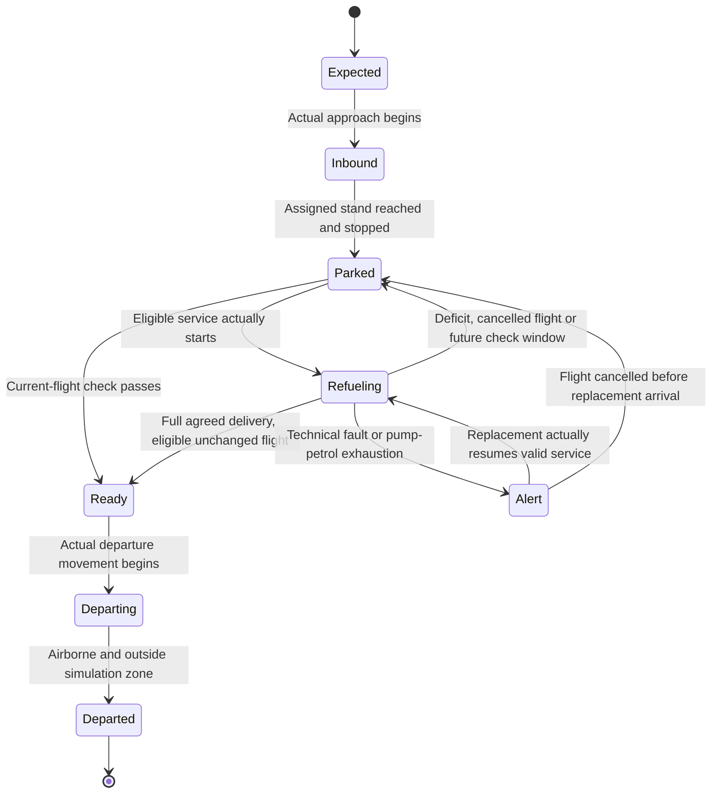

# Fuel Logistics — Domain and State Machines

**Status:** Working draft; eight aircraft states retained; normal request
completion/history and selected fault cases agreed; explicit depot replenishment
and Standby states supersede Loading; remaining transitions and event boundaries open

**Last updated:** 31 October 2026

**Primary decisions:** D-003, D-006, D-007, D-010, D-012–D-020,
D-022–D-026, D-030–D-041, D-043, D-044; dependencies D-021, D-027, D-042, D-045

**Review questions:** Q-03, Q-04, Q-05, Q-14; fuel dependencies Q-06, Q-07; modes Q-13

See the [requirements index](README.md#resume-checkpoint) for the continuation
point. Review one tanker transition at a time. The tables preserve the source
discussion's scope; open rows are not approved transitions or final enums.

## Entities and lifecycles

**D-003 — direction agreed:** Aircraft, fuel requests and refuellers need
separate lifecycles. One shared `Idle / Transit / Refueling / Maintenance` enum
does not describe them. USD statuses represent internal states; they do not
implement the state machines.

| Concept | Recorded role | Contract still needed |
| --- | --- | --- |
| Flight | Schedule, arrival type, destination/next leg and operational profile | Concrete flight/aircraft IDs and reassignment records |
| Aircraft | Physical service readiness and onboard aviation fuel | Final lifecycle, capacity/profile references and association with a flight |
| Fuel request | Independent service obligation; Completed after full agreed delivery; archived with actual transfers and executor changes under D-041 | IDs/versions, remaining state vocabulary, atomic updates and cancellation boundaries |
| Refueller | Tractor plus aviation-fuel semi-trailer with its own operational state | Complete transitions, resource guards, location and current assignment |
| Depot | Two exclusive-occupancy posts, agreed simultaneous-arrival order, separate auxiliary diesel/petrol dispensers and two-refueller parking under D-018/D-021 | Service rates, target quantities, remaining visit rules and internal holding/paths/timings |
| Waiting location | Main Parking or Staging Point; arrival and one-hour/event-driven waiting policy under D-022/D-024 | Geometry, accessibility, selection and simultaneous-event ordering |

Arrival type, stop purpose and a fuel-check result are separate data, not extra
enum states. Numerical fuel quantities are defined in [D-005](fuel_and_service_model.md#quantities-and-units).
Exact field names and serialisation beyond the recorded examples remain open.

## Aircraft lifecycle

**D-006 — agreed in discussion, 31 October 2026:** Use exactly eight aircraft
states. `Scheduled` and `Diversion` remain arrival types, not states.

| State | Meaning |
| --- | --- |
| `Expected` | Known arrival whose actual approach has not begun |
| `Inbound` | Actual approach, landing and taxi to the assigned stand |
| `Parked` | Stopped at its stand, awaiting a check, service or a new flight |
| `Refueling` | Aircraft service by a refueller has actually started |
| `Alert` | A selected refueller fault or pump-petrol exhaustion interrupted service; awaiting replacement |
| `Ready` | Fuel-ready, committed preparation for departure under D-037 |
| `Departing` | Actual movement from the stand, taxi, take-off run and take-off |
| `Departed` | Airborne and outside the simulation zone; terminal for this scenario |

Aircraft already on stands may initialise in `Parked`; they need not replay an
arrival. Initialisation is not an extra runtime transition. No separate landing,
taxiing, fuel-check or delay-risk state is required.

### Aircraft transitions

| ID | Transition | Trigger and guards | Required outcome |
| --- | --- | --- | --- |
| T1 | `Expected -> Inbound` | Provider reports actual approach start; ETA alone is insufficient | Begin the approach/landing/taxi phase |
| T2 | `Inbound -> Parked` | Assigned stand actually reached and aircraft fully stopped | Apply the current flight's check immediately if its window is already open |
| T3 | `Parked -> Ready` | Current-flight check window open, active flight and sufficient actual onboard fuel | Commit readiness under D-037; otherwise remain Parked and calculate deficit demand |
| T4 | `Parked -> Refueling` | Refueller actually arrives, aircraft eligible/ready to receive fuel and service starts | Commit the agreed service conditions under D-034; setup may be included in service duration |
| T5 | `Refueling -> Ready / Parked` | Full agreed delivery completes; D-041 closes the request | For an unchanged eligible flight, Ready without a second demand calculation. Changed/new/cancelled flights retain D-034/D-037 window and actual-stock guards; otherwise Parked with eligible additional demand only when required |
| T6 | `Ready -> Departing` | Actual movement from the stand for departure begins | Retain the commitment; do not infer movement from ETD alone |
| T7 | `Departing -> Departed` | Aircraft is airborne and has left the simulation zone | End that aircraft's participation in the current scenario |
| T8 | `Refueling -> Alert` | Selected refueller technical fault or pump-petrol exhaustion interrupts service (D-044) | Stop transfer, retain actual stock and outstanding committed quantity; faulty refueller follows D-035 |
| T9 | `Alert -> Refueling` | Replacement actually arrives and starts valid resumed service after checks/setup; outstanding commitment has not been cancelled | Transfer only the undelivered committed quantity; do not repeat earlier delivery |
| T10 | `Alert -> Parked` | Flight cancelled before replacement arrival (D-039) | Cancel the outstanding old-request commitment, retain delivered fuel and await a new flight/check |

`Parked -> Refueling` may recur for additional eligible demand. `FuelChecked`
and `Sufficient` are check results, not aircraft states. D-041 separates delivery completion from equipment release. Completed and Ready
do not authorise aircraft movement while hoses/equipment or the refueller still
obstruct departure. Detailed release timing and same-time boundaries remain Q-05.

An aircraft awaiting a tanker stays `Parked` until refuelling actually begins;
the request carries waiting/queue information. An inbound flight can be known to
the planner without being physically present or eligible for ground service.
Diversion does not itself establish highest refuelling priority.

The clarified schedule has three aircraft on stands, two inbound flights and a
possible sixth unscheduled arrival. The event can trigger a revised plan. The
earlier requirement for operator confirmation of every such change is reopened:
automatic dispatch is required, while the mode-specific confirmation and
intervention contract is open under [Q-13](planning_and_operator_workflow.md#operator-acceptance-and-unresolved-result-handling).
Physical animation need not depict every logical setup operation. D-037 fixes
committed readiness, not a full ATC or pre-flight inspection model. The eight
aircraft states are agreed; D-041 agrees request Completed and archive/history behaviour; the remaining
request enums and Q-05 boundary cases are not thereby finalised. D-040 separates schedule, prediction and actual
departure. The aircraft review retained the tanker model; the later D-043 depot review below
explicitly amends that model.

## Fuel check and request lifecycle

**D-007 — behaviour agreed, numerical timing open:** For each flight, configure ETD and
`predeparture_check_lead_time`. The proposed check time is `ETD - lead_time`;
1–2 hours is an example, not an agreed value. Compare `aircraft.fuel_onboard`
with `required_departure_fuel` from the [fuel model](fuel_and_service_model.md#aircraft-demand-model).

| Outcome | Aircraft effect | Request effect |
| --- | --- | --- |
| Sufficient fuel at current-flight check | Parked -> Ready | No request created |
| Calculated deficit | Remain Parked until service starts | Create a request for the missing uplift |
| Eligible service actually starts | Parked -> Refueling | Begin execution of the agreed delivery |
| Full agreed delivery, unchanged eligible flight | Refueling -> Ready | Completed; retain the closed record and transfer history |
| Earlier delivery completes before a changed/new flight's window | Parked even if stock is sufficient | Completed delivery retained; no premature new request |
| Changed/current-flight check finds a deficit when eligible | Parked awaiting additional service | Calculate additional demand from actual stock; identity/version detail remains open |
| Flight cancelled during running service | Parked after committed delivery | Complete the original delivery under D-034; no departure for the cancelled flight |

FuelChecked / Sufficient are check results, not aircraft states. D-041 agrees
Completed as a request status; other request enums are not yet finalised.
The first routine check creating a flight's request occurs in Parked. If the
window is already open on stand arrival, perform the check immediately after T2.
A changed/new flight retains its own check window and actual onboard fuel.
If its window opens during committed service, do not interrupt that service or
duplicate its demand. Exact lead time, ETD rescheduling and simultaneous-event
ordering remain Q-02/Q-06. Cancellation follows D-033/D-034/D-039.

### Normal completion and request history (D-041)

**Agreed in discussion, 31 October 2026:** For an unchanged flight whose
pre-departure check created the deficit request, transfer the full agreed uplift,
mark the request Completed and close it, and change the aircraft Refueling ->
Ready. A second calculation of the same flight's fuel need is not required.
Execution must still verify the actual delivered quantity and conserve the
aircraft/refueller balances; this is completion accounting, not another demand check.

Delivery completion, equipment disconnection and release of the service position
are distinct milestones. Completed closes the delivery obligation; the refueller
remains occupied until shutdown/disconnection/release permits its next movement.
Ready does not allow the aircraft to move while service equipment blocks it.
Precise timing, atomic event updates and a fault after full delivery but before
release remain open. Do not invent a Ready reversal to resolve that boundary.

After release, retain D-014/D-015/D-027 branching: directly serve another feasible
assigned aircraft, reposition to field waiting when unassigned, or return for
selected replenishment. For field waiting, Repositioning ends in Idle only on
actual arrival and stopping. The descriptive tanker word Parked in the review
maps to Idle; Aircraft Parked remains its own state.

All requests, including completed and cancelled ones, remain in the history/archive.
A partial transfer or change of executor does not automatically create a new
request. A replacement continues only the still-valid outstanding quantity of
the original request, using resource checks for that remainder. Retain causes,
interruption/resumption events, actual transferred quantities and executor changes.
Completed requires full agreed delivery; cancellation under D-039 closes only
the old undelivered obligation as cancelled, never as delivered. Exact archive
storage, request/commitment IDs, versions and other request states remain open.

D-041 covers normal completion; it does not remove D-034's cancelled-flight
outcome or D-037's changed/new-flight window and actual-stock checks.

## Request cancellation and revision (D-033)

**D-033 — agreed in discussion:** Before service starts, an explicit request
cancellation (for example a flight cancellation or removal of an erroneous
request) releases its tanker assignment. Mark the request cancelled, not
completed. A departure-time change alone does not cancel a request; recalculate
demand/timing and review assignments using the updated information.

If the tanker is already in `ToAircraft`, preserve actual position, travelled
distance, elapsed time and all fuel balances. Apply D-027 fleet assignment
review, then select one of the following:

- Valid alternative request, with all three fuel and route/readiness/time
  guards satisfied from actual position: remain `ToAircraft`, replacing the
  assignment and remaining route immediately, without a waiting-location stop.
- No selected service and no selected replenishment: enter `Repositioning`
  towards a permitted waiting location, then `Idle` on actual arrival.
- Replenishment necessary or preferred by the reviewed fleet plan: enter
  `ToDepot`, preserving protected diesel return and D-026 field coverage.

For a changed request, repeat feasibility and fleet-plan review. Continue to
the same aircraft only if the updated assignment is feasible and retained;
otherwise use the same reassignment/waiting/replenishment branches. No new
aircraft technical-failure scenario is introduced by this rule. Before-service
cancellation also removes unserved demand from the active queue; it does not
erase completed fuel transfers or mark a flight/aircraft departed.

## Started-service commitment and cancelled flights (D-034)

**D-034 — agreed in discussion:** On service start (entry into aircraft-service
`Refueling`, including D-012 setup), retain the request conditions/version under
which service began, including its agreed delivery quantity and identities.
Complete the started service under those conditions despite subsequent request
withdrawal, flight cancellation, schedule change or demand revision. Such events
do not rewrite the active delivery quantity or release the tanker early.
The exact commitment record/version format remains open.

Manual cancellation while committed aircraft service is running is **not allowed**.
The UI must make that restriction clear, and execution must also reject a late
cancellation command rather than relying only on a disabled button. An external
withdrawal/cancellation event may still be recorded, but does not cancel the
committed physical service. Same-time start/cancellation ordering is Q-02.

If the flight is cancelled during refuelling, finish the original committed
delivery and release the tanker using the normal post-service rules. The
physical aircraft remains fuelled and parked on the airfield, with no departure
for that cancelled flight. Represent it using `Parked` with no active flight
after service, rather than inferring `Ready` to depart from fuel sufficiency.
Keep the cancelled flight record distinct from the physical aircraft.

The Synthetic Data Provider may later assign **a new flight to that same
aircraft**. Bind the new flight identity/schedule without spawning a replacement
aircraft or resetting onboard fuel. Evaluate the new flight's fuel requirement
against the actual remaining onboard stock under the agreed check/eligibility
rules; create additional service only for a calculated deficit.

Ordinary cancellation/replanning must not interrupt committed service. D-035
requires immediate aircraft-service withdrawal on any detected technical fault,
even when some equipment can still function; D-044 selects the event catalogue.
D-034 does not override that technical-fault withdrawal rule.
**31 October exception (D-039):** After fault interruption, cancellation while
the aircraft is Alert and before replacement arrival cancels the old undelivered
commitment. This is not permission to interrupt running service manually.
Completion of the committed delivery and fuel-readiness for an updated/new
flight are distinct outcomes. D-041 fixes normal completion without a second
same-flight demand calculation; changed-flight readiness and remaining
identity/release sequencing retain their Q-05 boundaries.

## Aircraft interrupted service and committed readiness (D-036/D-037)

**D-036 — agreed in discussion:** If aircraft refuelling is interrupted by a
refueller's technical fault, or D-044 pump-petrol exhaustion, the **aircraft**
changes `Refueling -> Alert`,
retaining its actual onboard fuel and remaining service need. This identifies
an abnormal interruption, not a mechanical fault in the aircraft. It waits for
a replacement refueller. On actual arrival, readiness/setup and service guards
passing, use `Alert -> Refueling` to resume delivery of the reviewed outstanding
quantity, unless D-039 has cancelled that commitment. The faulty refueller follows D-035 separately. Aircraft and tanker
Alert are entity-specific states, not a shared lifecycle or assignment.

**D-037 — agreed in discussion:** After an earlier delivery, a changed flight
or a newly assigned flight is checked at **that current flight's pre-departure
fuel-check window**, using actual retained onboard fuel:

- Sufficient fuel for the current flight: `Parked -> Ready`.
- Insufficient fuel: remain Parked and retain/create additional calculated
  service need; a feasible assigned tanker supplies the deficit, followed by
  the current-flight readiness check.
- Flight cancelled with no replacement: remain Parked without an active flight;
  wait for a new flight from the provider and its applicable checks. Do not
  depart on the cancelled flight or discard already supplied fuel.

For this demonstration, **Ready commits the aircraft to departure**: once it
enters Ready, no later cancellation, flight change, fuel deficit or reversal of
readiness is generated. The provider/scenario must respect this simplification.
Execution must enforce this invariant for operator commands and other event
sources as well as the provider: reject cancellation, flight replacement or
readiness-revoking commands after Ready. The allowed continuation is
`Ready -> Departing -> Departed`, on actual movement and zone exit. D-040 governs
late readiness without a retrospective schedule rewrite. Do not add
Ready-to-Parked/Alert failure branches to this scope.
D-034's fixed started-delivery conditions remain unchanged: a revised flight
does not rewrite an in-progress delivery; its own fuel check uses actual stock.

### Interrupted-service cancellation (D-039)

**Agreed in discussion, 31 October 2026:** If the flight is cancelled while the
aircraft is Alert after a refueller fault and the replacement has not arrived,
use `Alert -> Parked`, remove the active flight and cancel the old request's
undelivered obligation. Previously delivered fuel remains onboard and in actual
issued-fuel history. Mark the remainder cancelled, not delivered or completed.

Release any replacement assignment for review from that vehicle's actual
position, preserving its travel, elapsed time and all fuel stocks. Use the
existing D-033 reassignment rules and all tanker/coverage guards; this adds no
tanker state or new route exception. A stale dispatch/service-start action for
the cancelled request must not resume delivery.

A new flight uses the same physical aircraft and retained stock. At its own
check window, sufficient fuel permits Ready; otherwise create a calculated
deficit request. Do not resurrect the cancelled remainder or count its earlier
delivery twice. For example, an 8-tonne operation interrupted after 3 tonnes
leaves 3 tonnes delivered and 5 tonnes cancelled. If the new flight needs 6
tonnes onboard, its uplift is 3 tonnes, not 5 or 6 (assuming no intervening burn).

The agreed exception is cancellation before replacement arrival. Cancellation
after arrival but before resumed service, and flight replacement without an
explicit cancellation while Alert, remain Q-05 boundary cases. Also specify
the distinct sequence of cancellation during running service followed later by
a fault; do not infer an extra cancellation event on Alert entry. While resumed
Refueling is running, D-034 applies again. The failed tanker's D-035 withdrawal
and maintenance path is unaffected.

### Departure timing boundary

See [D-040](planning_and_operator_workflow.md#departure-delay-risk-and-schedule-authority-d-040)
for the agreed distinction between scheduled ETD, predicted departure and actual
movement/take-off. Keep Schedule preserves the schedule, not a claim of
feasibility. If readiness occurs after ETD, continue the actual departure
sequence with lateness retained; never wait for a timestamp already passed.
Detailed preparation duration and movement scheduling remain to be specified.

## Tanker states

**D-043 — agreed in discussion, 31 October 2026:** Replace the former Loading
state with explicit replenishment states and use Repositioning for internal
depot movement. Standby becomes a state rather than a separate duty-role variable.
The visual assembly is KrAZ-221 + TZ-22 with the separately selected
[KrAZ-258B1 capability profile](reference_profiles.md#adopted-simulation-profile-d-042).

| State | Meaning |
| --- | --- |
| Idle | Available and stopped at a permitted field waiting location |
| Standby | At depot reserve parking, technically ready, service operations complete and all three stocks at 100% |
| ToDepot | Travelling to the depot for replenishment or maintenance; fault unavailability remains explicit |
| RefillTank | Timed replenishment of the semi-trailer's aviation fuel at its post |
| RefillServiceFuel | Timed diesel and pump-petrol replenishment at the auxiliary post; separate balances/operations |
| ToAircraft | Travelling to an assigned eligible aircraft |
| Refueling | Aircraft service, including setup under D-012; separate petrol pump drive, zero tractor diesel consumption |
| Alert Refueling | Tractor-to-tractor diesel assistance under D-032/D-038; explicit donor/recipient roles |
| Repositioning | Movement outside ToDepot/ToAircraft, including field waiting, coverage, assistance approach and internal depot movements |
| Maintenance | Technical repair; not ordinary replenishment |
| Alert | Exceptional unavailability/attention, including an immobile diesel-assistance recipient |

There are eleven recorded tanker states after replacing Loading and adding
Standby. The full transition matrix is not yet approved. Repositioning retains
the operation/destination and unfinished depot requirements; its name alone does
not make a vehicle available for assignment. No separate Active/Standby role
variables are introduced. Standby is depot readiness, not physical field coverage.

Under D-042, internal depot movement takes time but consumes no tractor diesel.
This deliberate simplification preserves full tanks on arrival at reserve parking.
Enter Standby only after actual arrival/stopping and all readiness conditions;
repair completion or arrival at a fuel post does not refill anything implicitly.
Idle is field waiting with actual stocks and is not a synonym for Standby.

D-038 retains separate aircraft Refueling and diesel-assistance Alert Refueling.
A faulty vehicle travelling in ToDepot remains unavailable until repaired.
A vehicle may serve several aircraft without visiting the depot when the plan
and all three resource guards remain feasible. Partial depletion alone does not
force a return; field waiting does not require full tanks.

## Locations and Repositioning

**D-013 — agreed in discussion; spatial details open; waiting policy extended by D-024:**

- **Fuel Depot:** One aviation-fuel replenishment base, separate from waiting
  locations; unlimited supply is defined by [D-004](fuel_and_service_model.md#depot-and-resource-accounting).
  D-018/D-043 define two replenishment posts, timed internal Repositioning and
  separate depot reserve parking with capacity for both refuellers. This depot parking area is
  distinct from terminal-side Main Parking and the Staging Points below.
- **Main Parking:** One main long-term parking location near the terminal.
- **Staging Points:** One or two authorised short-term waiting locations close
  to aircraft stands, outside areas where the tanker obstructs movement/taxiing.
- With no immediate next assignment after service, release the aircraft stand,
  move to a suitable Staging Point and wait there. After a long wait, move to
  Main Parking under D-024's agreed rule: more than one hour waiting, followed
  by a one-hour look-ahead for fuel-check windows. This replaces the earlier
  illustrative two-hour threshold.
- Destination (Main Parking or a particular Staging Point) is separate state
  data. A stationary available tanker is `Idle` at either waiting location;
  a new route can start from its actual location.

The D-013/D-014 wording conflict is resolved: `Repositioning` covers leaving an
aircraft stand for a waiting location as well as movement between waiting
locations. D-026 also uses it for depot-to-field replacement movement.
D-022 defines arrival; D-023 permits direct reassignment during ordinary
movement, with D-026's parking-first exception; D-024 defines the waiting decision. Geometry, location selection and
event ordering still require detail.

## Two-refueller rotation (D-016 — agreed in discussion)

- The full demonstration requires **two visually identical KrAZ-221 + TZ-22 refuellers**,
  using the KrAZ-258B1 capability profile under D-042,
  including provision for fault tolerance under D-017.
  Normally one is the **Active** duty vehicle on the airfield; the other is
  fully replenished and waiting at the Fuel Depot in **Standby**. Under D-043,
  Standby is an explicit state; active field duty is derived from actual state,
  location and assignment, without separate role variables. D-027 permits both vehicles
  to work on the field concurrently; the default is not a permanent requirement
  to keep one at the depot or to send a useful field vehicle back.
- After cuOpt/planning identifies the next fuel-service request, check whether
  the active vehicle can deliver its required aviation fuel and retain enough
  diesel to perform the service and reach the depot with a protected reserve.
  D-021 also requires sufficient pump petrol for the delivery with its operating
  reserve; apply all three checks to either duty vehicle.
  When it cannot serve that candidate, review assignments under D-027: the
  second can take it while the first remains for other feasible work.
- D-026 clarifies replacement dispatch: when the active vehicle needs depot
  replenishment, send the full Standby from depot to an authorised **field
  parking location**, without waiting for an aircraft request or check window.
  It can start moving before the active vehicle completes current service;
  that service remains uninterrupted. The replacement first arrives and stops
  at field parking, then departs from there for an eligible assigned aircraft
  once its fuel-check window opens and all assignment guards pass. The earlier
  direct-depot-to-aircraft relief wording is superseded for this handover.
- The current aircraft's refuelling remains uninterrupted. After completing
  it and disconnecting equipment, the vehicle returns to the depot if the
  D-027-reviewed plan selects replenishment and it is safely reachable. Otherwise
  it can remain for a feasible alternative assignment. At depot it replenishes aviation fuel, tractor diesel and
  pump petrol as required, then waits fully replenished as the new Standby.
  The two vehicles alternate field duty and depot reserve as needed. A partial-stock departure
  for a specific feasible assignment is allowed under D-020; it does not
  redefine the fully replenished Standby condition.
- Prevent running out of tractor diesel through dispatch guards. Exceptional
  diesel assistance from the second tractor is required under D-017 below;
  transfer equipment, access, timing and lifecycle details remain to be defined.
- Whether automatic rotation follows an accepted standing dispatch policy or
  requires acceptance of a particular revised plan remains open in the
  [operator workflow](planning_and_operator_workflow.md).

## Transition 4: Refueling to ToDepot

**D-015 — agreed in discussion for all three fuel stocks; amended by D-027:**
Insufficient aviation fuel, tractor diesel or pump petrol for one candidate
assignment first triggers [assignment review](planning_and_operator_workflow.md#assignment-review-and-two-refueller-field-operation-d-027).
After current service and equipment disconnection, retain the vehicle for an
alternative feasible assignment if selected by the reviewed fleet plan; use
transition 3A for that service. The second vehicle may handle the original
request while both remain on the field under D-016/D-027.

If no feasible alternative is selected, or the fleet plan selects replenishment,
return directly to Fuel Depot via transition 4 without a Staging Point detour.
This applies to any single-stock or mixed shortage. It never authorises an
infeasible service assignment. The earlier unconditional-return rule is
superseded by D-027; the depot-return branch itself remains agreed.

Insufficient diesel for the next assignment does not imply insufficient diesel
for the depot return. Normal checks must always preserve a reachable return
with the protected diesel reserve. If this safety condition unexpectedly fails,
use the required D-017 tractor-to-tractor diesel assistance before attempting
that return; do not command a journey without sufficient diesel. The return
behaviour is agreed. Open assistance implementation details under Q-03 do not
reopen this assignment-review and selected-replenishment behaviour.

## Diesel reserve and exceptional assistance (D-017)

**D-017 — required behaviour agreed in discussion; detailed mechanism open:**

- During normal operation, fuel-level and feasibility checks must prevent a
  tractor from being left without enough diesel to reach the Fuel Depot with
  the protected reserve. Reject an assignment that cannot cover its travel,
  service and protected return. Assistance is an exceptional recovery path,
  not a substitute for those normal resource guards.
- If a tractor nevertheless cannot reach the depot because of insufficient
  diesel, the second refueller must travel to it and transfer enough diesel
  from its own tractor tank to restore the recipient's feasible return to the
  depot. This is tractor-to-tractor diesel transfer, separate from the aviation
  fuel in either semi-trailer.
- Calculate the required transfer from the recipient's actual diesel balance,
  reachable return path, adopted consumption model and minimum reserve. Respect
  its tank capacity; a guessed fixed transfer amount is not the requirement.
- Validate the assisting vehicle's approach and protected return as well. The
  donation must leave it enough diesel for its own feasible remaining movement
  and any transfer-related consumption included in the adopted model.
- Account for diesel leaving the donor and entering the recipient separately
  from any consumption. Transfer is an explicit operation with duration, not a
  free resource reset or an instantaneous scene change.
- D-032 below fixes waiting, approach, transfer and departure behaviour. If the
  second vehicle is busy, wait until its current service/work is complete;
  ordinary aircraft refuelling is not interrupted for this assistance.
  Equipment, connection/setup, transfer rate/amount calculations and exact
  record formats remain under Q-03/Q-05/Q-07. Apply Q-13 authorisation without
  changing the agreed assistance sequence.

### Diesel-assistance state sequence and scenario scope (D-032)

**D-032 — agreed in discussion:**

1. A refueller unexpectedly lacking diesel for its protected depot return
   enters `Alert` at its actual location and waits for the second vehicle.
   It is unavailable for aircraft assignments. Use **Alert!** as the working
   visible designation for such exceptional situations; which other faults
   use this state/indication is defined by D-044 and remaining Q-14 detail.
2. If the second vehicle is busy, the recipient remains `Alert` until that
   work finishes. Schedule assistance next rather than interrupting its current
   aircraft service or declaring assistance impossible merely because it is busy.
3. The donor travels to the recipient in `Repositioning`, with the assistance
   destination/task identified separately from an ordinary waiting-location
   move. It need not visit field parking first: D-026's aircraft-coverage
   replacement trip is a different operation. Check approach, donation and
   the donor's own protected return. If necessary, use the donor replenishment
   branch below before assistance;
   the recipient continues waiting. Do not waive fuel guards.
4. On actual arrival and completion of required setup, both participants enter
   `Alert Refueling` for a **tractor-diesel assistance** operation. Record donor and
   recipient roles and the diesel being transferred. Aircraft service remains
   a separate Refueling operation; no aircraft changes state or receives fuel
   merely because two trucks are transferring diesel.
5. Once enough diesel has been transferred and the operation completed, check
   the recipient's protected return and send it **directly to Fuel Depot**:
   `Alert Refueling -> ToDepot`. The recipient does not take a new aircraft request
   before this return.
6. Independently recheck the donor's actual aviation fuel, tractor diesel and
   pump petrol after approach/transfer consumption. It may depart for a valid
   feasible aircraft assignment (`Alert Refueling -> ToAircraft`), move to an
   authorised field waiting location (`Alert Refueling -> Repositioning`, then Idle
   on arrival), or return for replenishment (`Alert Refueling -> ToDepot`) under
   D-027 assignment review. Do not debit the donation twice or reset stocks.

**Donor replenishment before assistance — D-032 clarification:** After its current
work, check whether the donor can reach the recipient, transfer enough tractor
diesel to restore the recipient's protected depot return, and retain enough
for its own protected return. If not, the donor **first returns to Fuel Depot**
in `ToDepot`, using its actual remaining diesel; normal reserve checks must
already cover that trip. The recipient remains in `Alert` throughout travel,
depot operations and subsequent approach.

At depot arrival use the required RefillTank/RefillServiceFuel visits under
D-043. Replenish **both the donor's tractor diesel
and its semi-trailer's aviation fuel**, even though the assistance itself is a
tractor-diesel transfer. Check pump petrol independently under D-021 and top it
up if required by the readiness/next-work policy. Account for the agreed post
sequence, occupation, loading and internal travel time; no instantaneous refill.

After required replenishment and successful repeated assistance fuel checks,
go directly into Repositioning towards the recipient after completed operations, then use D-032's
`Alert Refueling` transfer. The assistance task remains assigned through the
depot visit: no intermediate depot-parking/Standby step or field-parking stop is
required. D-019/D-043's no-task Standby branch does not apply to this assigned
assistance departure. Do not insert another aircraft job before the agreed
assistance merely to avoid the donor's necessary replenishment.

**Bounded scenario assumption:** The modelled airfield's assistance locations
are reachable over the normal traversable ground network. Road destruction,
impassable obstacles and disaster-driven inability to reach the recipient are
outside this scenario scope; do not add such failure branches to D-017.
Being occupied is handled by waiting. Scenario inputs must support the second
vehicle's eventual assistance, including any needed replenishment, while
preserving the existing fuel checks. Concurrent technical faults remain the
separate Q-14 catalogue discussion, not an implicit extension of D-032.

Do not count the Alert recipient as ready field coverage. Record any actual
exceptional gap until readiness is restored; the normal D-026 coverage rule
does not permit labelling an unavailable vehicle ready. Alert notification
acknowledgement/clearing and detailed assistance request records remain to be
defined without reopening this state sequence.

## Depot loading and departure

### Transition 5: ToDepot to replenishment

**D-018, amended by D-043:** Actual depot arrival selects the required post or
repair destination. Replenishment starts only after actual arrival at an available
post; use Repositioning for internal travel and account for necessary coordination
waits. At the aviation post enter RefillTank; at the auxiliary post enter
RefillServiceFuel. Ordinary replenishment does not enter Maintenance.

The aviation post loads the semi-trailer. The auxiliary post has separate diesel
and pump-petrol dispensers. Each post holds one vehicle; one vehicle cannot use
both spatially separated posts simultaneously. Required visits and movement are
sequential for that vehicle, while the two vehicles may use different posts
concurrently. Diesel and petrol dispensing order within the auxiliary post,
post rates, safe holding geometry and first/second tie-breaking remain open.

Preserve D-018's agreed simultaneous-arrival order:

1. The first uses aviation loading; the second uses the auxiliary post.
2. The first completes its required visits, including the auxiliary post when
   needed and after the second has cleared it, then departs or proceeds to parking.
3. The second then uses the vacated aviation post. Respect post clearance and
   any required holding/movement; do not assume simultaneous swaps or equal durations.

Outside that specific sequence, choose the necessary visits/order under the
remaining visit policy. An unnecessary post can be skipped for a feasible
assignment; entering Standby requires all three stocks at 100%. RefillTank ->
Repositioning -> RefillServiceFuel and the reverse order describe separate timed
visits, not permission to override the simultaneous-arrival agreement. Separate
depot parking holds both vehicles; both at depot still fail normal field coverage.

Internal depot travel consumes time but no tractor diesel under D-042. Depot
pumping equipment/petrol consumption and numerical replenishment/repair durations
remain to be specified; do not infer free use of the onboard petrol engine.

### Transition 6: Replenishment to Standby

**D-019, amended by D-043:** Without an assigned service or D-032 assistance task,
complete the replenishment needed for reserve duty: aviation fuel, tractor diesel
and pump petrol at 100%, confirmed technical readiness and completed operations.
Move to depot reserve parking in Repositioning, then enter Standby only after
actual arrival and stopping. No direct field Idle -> Standby transition exists.

A vehicle en route to depot parking may take a valid eligible assignment under
D-030 after required operations are complete and all guards pass. It need not
reach parking, stop or enter Standby. Incomplete replenishment is not cancelled
merely because the vehicle's current state is Repositioning.

### Transition 7: Completed replenishment to ToAircraft

**D-020/D-030, amended by D-043:** After completing the required operations and
releasing equipment, an eligible aircraft assignment may depart directly from
the depot or redirect during Repositioning to depot parking. Check actual
position, all three remaining stocks, route/readiness/time and the protected
diesel return. No depot parking arrival, Idle or Standby step is required.

For a specific assignment, aviation fuel must cover its full assigned uplift,
pump petrol its pumping requirement and reserve, and diesel the counted travel
and protected return. Partial stocks are permitted when every guard passes;
full tanks are mandatory for Standby, not for every depot departure.
If guards fail, retain the necessary replenishment/assignment-review branch.

D-026 coverage replacement remains distinct: dispatch to field parking and
actually arrive/stop there before eligible aircraft-bound departure. D-032
assistance departure remains direct to its recipient after preparation, without
an intermediate depot or field parking stop. A new state name does not waive
either task's existing route/eligibility rules.

## Waiting, reassignment and proactive replenishment

### Transition 8: Repositioning to Idle

**D-022 — agreed in discussion:** On actual arrival and stopping within the
assigned permitted Staging Point or Main Parking, complete the waiting-location
route and enter `Idle` if no aircraft-service assignment has been made. Record
the actual location; subsequent routes start there. `Idle` means available for
selection, not automatically feasible for every request or fully replenished.
All three fuel guards and the other feasibility checks apply to each assignment.
Depot reserve parking arrival enters Standby under transition 6/D-043, not Idle.

### Transition 9: Repositioning to ToAircraft

**D-023 — agreed in discussion:** A refueller travelling to a waiting location
may immediately take a valid assigned aircraft-service request after all
feasibility checks pass. Check aviation-fuel uplift, pump petrol with operating
reserve, and diesel for the route from the vehicle's **actual current position**
to the aircraft, service/manoeuvres and protected depot return. Also check the
aircraft's eligibility/readiness, route and service timing.

For ordinary repositioning, replace the remaining waiting-location route and enter `ToAircraft` directly.
The vehicle need not first reach or stop at the Staging Point or Main Parking;
no intermediate `Idle` is required. Preserve its position, elapsed travel and
spent fuel. Receiving a request or computing a candidate plan is not itself an
executable assignment. Authorisation follows Q-13. D-030 covers assignment during
Repositioning to depot parking after completed replenishment (D-043). D-026's replacement
trip from depot to field parking must complete its parking arrival first;
it is an explicit exception to direct in-motion aircraft assignment.

### Transition 10: Idle to Repositioning

**D-024 — agreed in discussion:** Start Staging Point waiting time on actual
arrival and entry to `Idle`. When waiting exceeds **one hour** and there is no
assigned service, inspect the current schedule for flights whose pre-departure
fuel-check window opens within the **next hour**:

- If any exist, remain `Idle` at the Staging Point and await possible assignment.
- If none exist, travel to Main Parking near the terminal in `Repositioning`;
  return to `Idle` only after actual arrival and stopping under transition 8.

Any new arrival/departure schedule event, or change to an existing one, triggers
a fresh assessment using current location, fuel, known/anticipated demand and
assignments. Opening an expected fuel-check window also triggers assessment.
If its fuel check creates no request, assess the following hour again. Crossing
the one-hour dwell threshold must trigger the initial assessment even when no
schedule change occurs. This is an event-driven rule, not an agreed polling
interval; a timer must not replace reactions to schedule changes.

The one-hour dwell gate applies to moving an unassigned vehicle from Staging
Point to Main Parking. It does not postpone response to a feasible service
assignment or an anticipated shortage under D-025. Main Parking does not
automatically launch the same Staging Point dwell rule. Schedule knowledge or
opening a check window alone is not an aircraft-service request.

### Waiting or repositioning to ToDepot

**D-025 — agreed in discussion:** Event-driven assessment can identify that an
available waiting refueller lacks aviation fuel, tractor diesel or pump petrol
for a known upcoming candidate. First review alternative assignments under
D-027; retain it on the field for suitable work if selected. If the reviewed
plan selects replenishment instead, send it to the Fuel Depot using
`Idle -> ToDepot`, or `Repositioning -> ToDepot` if it is still moving to a
waiting location. This proactive return need not wait for the one-hour dwell
threshold or an aircraft-service assignment that would fail the resource checks.
Use its actual current position and preserve the protected diesel return;
an unexpected failure requires D-017 assistance before travel.

Replan the two-refueller rotation concurrently under D-026. Dispatch the fully
replenished depot Standby to field parking to replace the vehicle being sent
for replenishment; do not wait for an aircraft request/window to start this
replacement movement. From field parking, aircraft-bound departure requires
an open check window, an actual assigned fuel-deficit request and all three
fuel/resource, route and readiness/time guards. Do not treat a future flight
as already service-ready or restore the returning vehicle's stock before its
timed depot operations.

For example, if a waiting vehicle has **10 tonnes** of aviation fuel and new
information establishes **12 tonnes** of required uplift for a diversion or
transit flight, first look for other feasible work. It can remain for an
8-tonne request while the full second vehicle handles the 12-tonne request.
Only a selected replenishment branch sends the first to depot.
These are synthetic mass quantities, not a litre conversion or equipment-capacity
claim. Verify that the Standby's usable stock actually covers 12 tonnes plus
the other assignment constraints; being full alone does not prove feasibility.
Arrival type does not itself decide priority. D-025 extends D-016's relief to
waiting/repositioning vehicles without interrupting ongoing aircraft service.

### Field coverage and replacement from depot (D-026)

**D-026 — agreed in discussion:** During normal system operation,
at least **one operationally ready refueller must be physically on the airfield**.
Sending an active vehicle for replenishment therefore requires dispatching its
fully replenished replacement from the depot, irrespective of whether the next
aircraft's fuel-check window has opened. Coverage readiness and availability
for a particular service are distinct from the tanker state and displayed duty;
a vehicle at the depot does not provide physical field coverage.

D-027 permits **both** refuellers on the field for feasible work. D-026 is a
minimum-presence requirement, not a one-vehicle field limit or a requirement
to preserve an occupied depot Standby position. The full second vehicle can
also be brought out for a request the first cannot serve while retaining the
first for another feasible assignment; its field-parking arrival still applies.

The depot reserve leaves `Standby -> Repositioning` under D-043 towards an authorised field
parking location (Staging Point or Main Parking as selected by the spatial
policy). It must actually arrive and stop, entering `Idle` under transition 8.
This is not a direct depot-to-aircraft assignment, even when the arriving
aircraft's demand is already known. Once that aircraft's fuel-check window is
open, an actual service request exists and all assignment checks pass, dispatch
from field parking via transition 1 (`Idle -> ToAircraft`). D-023 does not bypass
the replacement's required field-parking arrival. A separate aircraft assignment
after depot loading under D-020 remains distinct from this coverage handover.

Plan replacement travel and the relieved vehicle's departure so that **no
planned interval has zero ready refuellers on the field**. A dispatch command
or replacement still travelling outside the field is not evidence of physical
coverage. Exact handover timing, field boundary and measurable readiness criteria
must be specified under Q-02/Q-04/Q-07; they must satisfy this invariant. If the
first has already left and the second has not reached the field, record an
actual coverage gap rather than claiming the dispatch itself maintained coverage.

The two-vehicle simultaneous-depot-arrival procedure under D-018 still defines
post operations, but both refuellers at depot cannot satisfy D-026 during covered
operation. Normal planning must not choose that configuration as a covered
handover. Handling loss of coverage or an unavailable replacement remains an
explicit exception requirement; do not silently assume another vehicle exists.

## Maintenance framework and fault catalogue (D-031)

**D-031 — framework agreed; fault withdrawal clarified by D-035:** `Maintenance` means
technically unavailable for aircraft service. Exclude the vehicle from new
service assignments while retaining its actual location, fuel balances and
already delivered quantities. A maintenance event does not replenish fuel or
move the vehicle to the depot automatically. The working assumption is a
maintenance area on the depot site; confirm its spatial/service details.

### Planned entry

Record the need for maintenance separately from the current operational state,
stop new assignments and replan future work. Complete current aircraft service
without interruption. Coordinate the second vehicle's actual field readiness
under D-026 before a planned withdrawal. Travel to the depot with protected
diesel reserve in `ToDepot`, then enter `Maintenance` on actual arrival at its
maintenance area. Arrival for maintenance selects `ToDepot -> Maintenance`;
arrival for replenishment selects the required post under D-043. Maintenance need/reason
is conceptual metadata, not a new tanker state or an approved schema field.

### Fault withdrawal and depot return (D-035)

**D-035 — agreed in discussion:** A detected technical fault immediately removes
the refueller from aircraft service, independently of the particular fault type.
Do not finish its current aircraft delivery or give it another job merely
because some equipment still functions. Stop the current operation and account
for actual partial delivery, time and resources; retain the unmet demand for
replanning. This supersedes the earlier fault-type-dependent choice of whether
service must stop. Planned maintenance without a detected fault remains the
separate planned-withdrawal branch above.

Direct the faulty vehicle to the depot maintenance area immediately after
necessary operation shutdown/equipment release. For a vehicle capable of
self-propelled return, use **current state -> ToDepot -> Maintenance**: technical
unavailability applies from detection throughout the return, and Maintenance
begins on actual arrival. Use an Alert! indication/reason to expose the fault;
being in ToDepot does not make it eligible for assignments or ready coverage.
If already at the maintenance area, enter Maintenance without inventing a trip.
Movement, arrival and maintenance take actual time; there is no teleportation.

Self-propelled return still requires mobility and enough diesel with protected
reserve. If a selected event prevents movement, keep the unavailable vehicle in
Alert at its actual location; Q-14 must define that recovery rather than command
impossible travel. No towing is implied by D-017. The fault catalogue selects
events, component/mobility effects and repair conditions; it does not reopen
the agreed rule that faulty equipment stops aircraft work and returns for
maintenance when able. An unplanned fault does not wait for completion of the
current delivery or a replacement's arrival; record any resulting exceptional
coverage gap and replan the second vehicle.

### Exit

Require recorded repair completion and technical readiness, then recheck actual
stocks and the next task. Repair does not refill any stock. Use the required
RefillTank/RefillServiceFuel visits with timed Repositioning when replenishment
is needed. A valid feasible aircraft assignment may depart after repair/release
without mandatory reserve parking, retaining D-026's distinct coverage route.
Without a task, replenish all three stocks and reach reserve parking before
Standby. Full transition coverage and spatial repair-area exit details remain open.

### Q-14: selected fault catalogue and interrupted service (D-044)

**Agreed in discussion, 31 October 2026:** The selected catalogue contains:

| Event | Modelled effect and recovery |
| --- | --- |
| Tyre puncture during Repositioning | Under this scenario assumption the tractor remains mobile but is unavailable for aircraft service. Expose Alert/reason, review any affected assignment and return in ToDepot; enter Maintenance at the repair area for wheel replacement |
| Pump failure during Refueling | Stop transfer immediately; Aircraft Refueling -> Alert. Retain original request and actual delivery. The mobile failed vehicle returns unavailable in ToDepot, then Maintenance; a feasible replacement resumes only the still-valid remainder after actual arrival/setup |
| Pump-petrol exhaustion during Refueling | Operational exception that normal guards must prevent. Stop transfer, retain balances/request and place the aircraft in Alert; the mobile vehicle returns for petrol replenishment, not pump repair. A feasible replacement continues the original remainder |

The tyre case is limited to Repositioning; do not silently extend it to ToAircraft
or ToDepot, or adopt additional faults at arbitrary transitions. If the affected
task is coverage or assistance rather than aircraft service, replan that actual
task; do not invent an aircraft assignment from the state name.

For a mobile technical fault, D-035's unavailable ToDepot -> Maintenance sequence
remains in force after shutdown/release. Alert indication/reason does not grant
eligibility during return. Pump-petrol exhaustion is an operational shortage;
Maintenance is reserved for technical repair. Pump repair takes longer than
ordinary petrol replenishment in the selected qualitative profile; exact travel,
repair/replenishment durations and completion evidence remain parameterisation work.

The separate petrol engine powers pumping. Tractor diesel consumption in
Refueling is zero under D-042, so exhaustion caused by service-time diesel use
is excluded. The earlier donor branches for continuing aircraft service after
such exhaustion are superseded. This does not cancel D-017/D-032's existing
exceptional protected-return assistance. Any further movement-exhaustion event
scope must be reviewed separately; guards still prevent routine diesel stranding.

Resume aircraft Alert -> Refueling only when the replacement actually arrives
and starts valid service after checks/setup, not on arrival alone. D-039 still
cancels the old remainder if the flight is cancelled before replacement arrival.
Do not reset fuel, duplicate the request or count unserved fuel as delivered.
The route for urgent aircraft takeover, including any field-parking exception,
and simultaneous-event ordering remain open. No fault probabilities, towing or
new immobile technical recovery are adopted by this catalogue.

## Tanker transitions

The following records reviewed behaviour in the D-043 vocabulary. It is not a
complete new transition matrix. Retained IDs identify behaviour/provenance,
including where a former Loading transition now spans explicit post/movement states.

| Transition | Trigger and result | Status and limits |
| --- | --- | --- |
| 1: Idle -> ToAircraft (D-011) | Eligible assignment, all three resource and route/readiness/time guards pass | Agreed; shared queue and Q-13 authorisation |
| 2: ToAircraft -> Refueling (D-012) | Actual arrival, aircraft ready, service starts including setup | Agreed; balances change with actual transfer |
| 3A: Refueling -> ToAircraft (D-014/D-041) | Current delivery complete, equipment disconnected, next feasible assignment | Direct next service; no mandatory waiting stop |
| 3B: Refueling -> Repositioning (D-014/D-041) | Service released, no selected next service or replenishment | Travel to field waiting; Idle only on arrival/stop |
| 4: Refueling -> ToDepot (D-015/D-027) | After release, assignment review selects replenishment | Protected return and coverage; not automatic after one failed candidate |
| 5: Depot arrival -> required post (D-018/D-043) | Actual arrival/routing; RefillTank or RefillServiceFuel begins at its available post, with Repositioning for internal travel | Timed exclusive posts, agreed simultaneous-arrival order and coordination waits |
| 6: Completed replenishment -> Repositioning -> Standby (D-019/D-043) | No task; all three stocks full, technically ready; actual reserve-parking arrival/stop | Internal depot travel takes time and no diesel; no Idle insertion |
| 7: Completed replenishment / parking-bound Repositioning -> ToAircraft (D-020/D-030/D-043) | Valid assignment and all guards pass after operations/release | Partial stocks permitted; no reserve-parking arrival or Standby required |
| 8: Repositioning -> Idle (D-022) | Actual arrival/stop at field waiting, no service assignment | Depot reserve parking uses Standby instead |
| 9: Ordinary field Repositioning -> ToAircraft (D-023) | Eligible feasible assignment from actual position/stocks | Immediate redirection; D-026 parking-first replacement exception retained |
| 10: Idle -> Repositioning (D-024) | Staging Point dwell exceeds one hour and no check window in next hour | Move to Main Parking; reassess on schedule/check events |
| 11/12: Idle or field Repositioning -> ToDepot (D-025/D-027) | Assignment review selects replenishment for known demand | Protected return and coordinated field relief |
| 13: Standby -> Repositioning (D-026/D-027/D-043) | Coverage replacement or selected two-vehicle field plan | No aircraft request needed for parking trip; actual field-parking arrival precedes service |
| ToAircraft -> ToAircraft / Repositioning / ToDepot (D-033) | Unstarted request cancelled/revised; fleet review selects next action | Retain actual position, elapsed time and stocks |
| Refueling retained on cancellation/revision (D-034) | Running commitment continues original delivery | Reject manual interruption; D-044 faults/shortage stop service |
| Protected-return deficit -> Alert (D-017/D-032) | Unexpectedly insufficient diesel for protected return | Unavailable recipient waits; busy donor finishes current work |
| Available donor -> Repositioning (D-032) | Assistance feasible for approach, donation and both protected returns | Otherwise prepare at depot first |
| Donor -> ToDepot -> required replenishment (D-032/D-043) | Own depot trip feasible, but assistance needs replenishment | Replenish diesel and aviation fuel, check petrol separately; recipient remains Alert |
| Prepared donor -> Repositioning towards recipient (D-032/D-043) | Required depot operations complete, repeated checks pass | No depot/field parking or intervening aircraft task |
| Donor Repositioning / recipient Alert -> Alert Refueling (D-032/D-038) | Actual assistance arrival/setup | Explicit diesel transfer, elapsed time and donor/recipient balances |
| Recipient Alert Refueling -> ToDepot (D-032) | Transfer complete; protected return restored | Direct depot return; no aircraft service before return |
| Donor Alert Refueling -> ToAircraft / Repositioning / ToDepot (D-032) | Recheck all three actual stocks and next task | Assignment, waiting or replenishment under reviewed guards |
| Mobile technical fault -> ToDepot -> Maintenance (D-035/D-044) | Stop/release work, retain unavailability and partial delivery; actual repair-area arrival | Selected tyre/pump cases; return requires mobility and diesel |
| Pump-petrol exhaustion -> ToDepot -> replenishment (D-044) | Stop service, aircraft Alert, retain request/remainder | Operational shortage; no automatic Maintenance |
| Maintenance -> required replenishment / ToAircraft (D-031/D-043) | Repair complete, actual stocks checked; assignment if feasible | No implicit refill; no-task route reaches full reserve parking before Standby |

D-042 quantifies the diesel/petrol guards; zero diesel in aircraft Refueling and
internal depot travel does not remove travel time or road-return reserves.
Aircraft-service interruption, Completed and actual readiness remain independent
of tanker destination. The remaining full matrix, waits, release/event ordering
and urgent replacement route are still requirements work.

## Open questions and next steps

- **Q-03:** D-032 closes assistance states, busy-donor waiting, recipient return
  and donor follow-up. Detail equipment/setup, transfer rates/amount calculations,
  event ordering and records under the reachable-airfield assumption; no
  impassable-road/disaster case is required.
  Transition 4's reviewed replenishment branch for all fuel shortages is agreed
  under D-015/D-027; assignment review precedes any selected return. Q-03 does
  not reopen that policy.
- **Q-04:** D-022–D-026 close waiting arrival, the one-hour/event-driven Staging
  Point policy, direct assignment during Repositioning and proactive shortage
  return/relief. Detail waiting-location geometry/selection, field boundary,
  readiness criteria and handover timing that preserves physical field coverage.
  D-030/D-043 retain direct assignment during parking-bound Repositioning after
  depot operations are complete;
  simultaneous-event ordering remains under Q-02.
- **Q-05:** Eight aircraft states, T1–T10, current-flight check gating and the
  D-039 cancellation exception are agreed. Define request/commitment identities,
  remaining closure/release ordering and atomic updates; cancellation after
  replacement arrival but before resumption; replacement without explicit
  cancellation while Alert; cancellation during running service followed later
  by a fault; and the boundary for a fault after the full uplift
  but before service release. Cancellation outside the reviewed parked/service
  cases is not implicitly approved. Define assistance requests separately.
- **Q-06/Q-07 dependencies:** Apply D-042's selected litre-valued profile,
  reserves and movement/pumping assumptions. Define aircraft conversion/profile
  details, tolerances, depot rates, setup/engine allowances and remaining visit rules.
- **Q-13 dependency:** Define which dispatch/replanning actions are automatic and
  where confirmation or intervention applies without changing physical guards.
- **Q-14:** D-044 selects the tyre/pump/petrol-exhaustion cases and excludes
  service-time diesel exhaustion. Define event timing, concrete repair-completion
  evidence/durations and urgent replacement routes; additional movement-exhaustion
  or immobile technical recovery is not silently added. D-017/D-032 remain retained.

For further review, follow the sequence in the [resume checkpoint](README.md#resume-checkpoint).
Only extend a state table or its diagram after the corresponding behaviour is
agreed. Keep agreed transitions distinct from provisional models and open rows.
